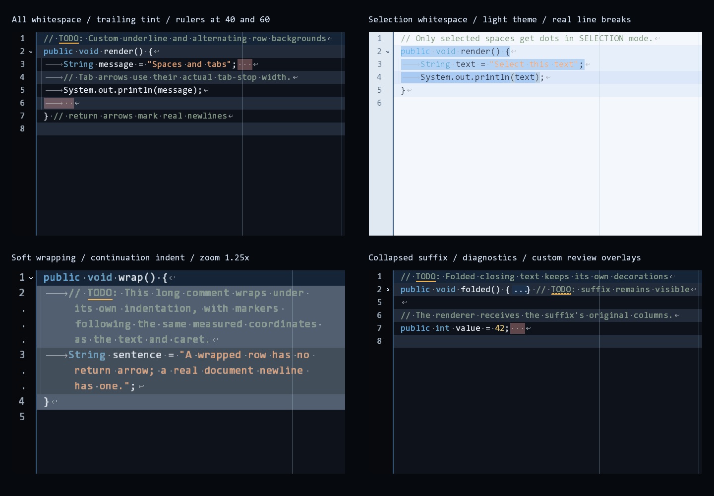
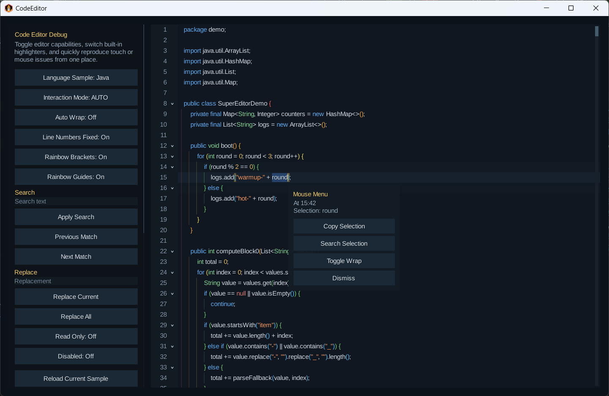
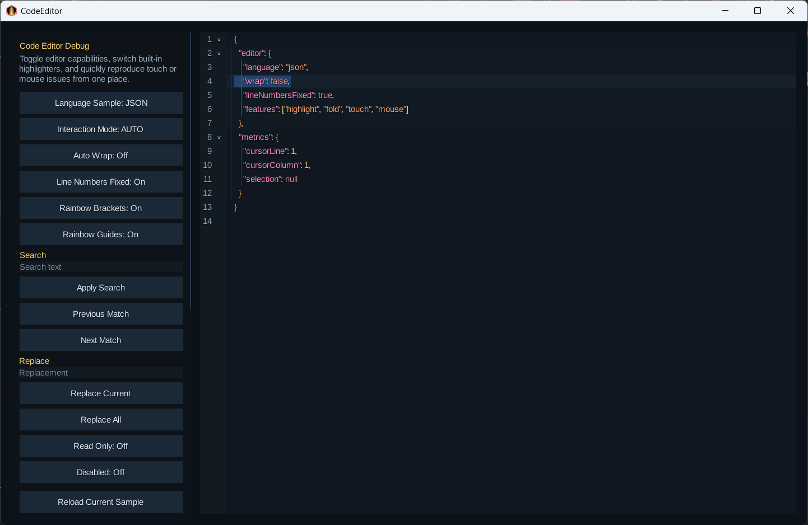
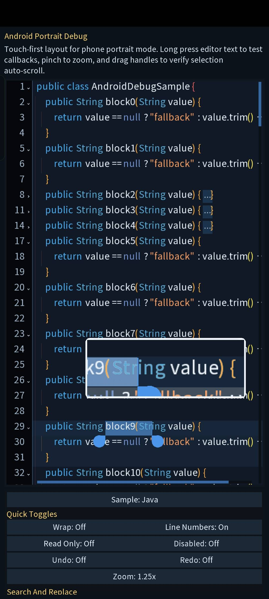
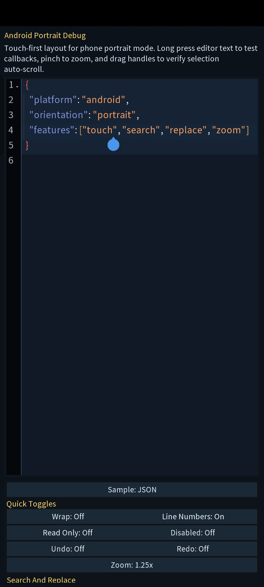

# gdx-code-editor

`gdx-code-editor` is a libGDX Scene2D code editor widget for large-text editing, syntax highlighting, code folding, search/replace, and touch or mouse interaction.

The library is designed for in-app script editors, config editors, lightweight IDE tools, and any Scene2D UI that needs an embeddable code editor.

See [CHANGELOG.md](CHANGELOG.md) for release notes.
See [the implementation review](docs/EDITOR_REVIEW.md) for current limitations and planned improvements.

## Features

- Scene2D `Widget`-based `CodeEditor`
- Large-text line-based document model, built for 100k+ lines
- Incremental syntax highlighting, only for lines on screen
- Semantic highlight overlay, for the local-vs-field-vs-parameter distinction a lexer cannot make
- Code structure analysis and folding
- Symbol tree for an outline, a breadcrumb and go-to-symbol
- Fixed or scrolling line numbers
- Search highlight and current-match highlight
- Literal, whole-word and regular expression search, optionally confined to the selection
- Optional Scene2D find and replace toolbar with live match counts and keyboard shortcuts
- Find next / previous match
- Replace current / replace all
- Undo / redo with named compound edits and a configurable history budget
- Rainbow brackets and rainbow guides
- Optional space/tab markers, trailing-whitespace tint, real line-break symbols and column rulers
- Custom background/foreground row layers with measured columns, wrapping and collapsed-suffix geometry
- Touch and mouse interaction modes
- Touch handles, long press, inertial scrolling, pinch zoom
- Scroll state queries and a listener, covering touch pan, fling and every other scroll source
- Right-click / long-press integration hooks
- Read-only and disabled modes
- Rebindable keyboard shortcuts through a named-action keymap
- String-ID command registry with metadata, enable conditions and exact shortcuts for host actions
- Searchable, keyboard/touch command palette with live availability and shortcut hints
- Runtime command shortcut rebinding, with atomic conflict checks
- Optional extensions with scoped resources, install rollback and deterministic unload
- Undoable uppercase/lowercase selection and trailing-whitespace cleanup extension
- Whole-line move, duplicate and delete commands, preserving caret and selection direction
- Optional line-comment toggling with configurable language prefixes and Ctrl/Command+/
- Code completion with a built-in popup and documentation side panel
- Multiple named completion sources with async merging, cancellation and scoped extension registration
- Reusable snippet-pack extensions with conditional availability and independent unload
- Snippets with placeholder tabbing, mirrored stops, choices and variables
- Hover tooltips and parameter hints
- Optional go-to-line/column dialog with validated 1-based input, fold reveal and Ctrl/Command+G
- Go to definition, find references and rename, with a word-level fallback
- Pluggable document/selection formatting with async cancellation, atomic edits and a strict JSON provider
- Optional diagnostic quick fixes and refactoring actions with preview, explicit apply and Alt+Enter discovery
- Auto-closing brackets and quotes, wrap selection, pair delete
- Line marks for breakpoints, bookmarks and change bars
- Configurable indent strategy, block indent and Shift-Tab dedent
- Diagnostics with squiggles and gutter marks
- Rich text on any highlight span: bold, italic, strikethrough, background, gradient, and plain, double,
  wavy, dashed or dotted underlines, which compose across overlapping spans
- Inline images in place of a glyph — icons or real emoji, including supplementary characters — measured
  like any other column, and clickable and hoverable through a listener
- Caret geometry and coordinate-mapping queries for custom overlays
- Public extension points for:
  - syntax highlighting (whole-document or incremental)
  - code structure analysis
  - interaction behavior
  - auto-edit behaviour on typing, Backspace and Enter
  - content, caret, hover and scroll observation
  - keyboard interception
  - key chord to named action mapping
  - custom commands and extension lifecycle
  - navigation (definition, references, rename)
  - document and selection formatting (synchronous or asynchronous)

## Screenshots

### Rendering aids and custom row layers


### Java editing and context menu


### JSON highlighting


### Android portrait mode with touch selection handles


### Android portrait mode with touch cursor


## Installation

Add JitPack:

```gradle
repositories {
    mavenCentral()
    maven { url 'https://jitpack.io' }
}
```

Add the dependency:

```gradle
dependencies {
    implementation 'com.github.Lzt841:gdx-code-editor:v1.5.0'
}
```

Kotlin DSL:

```kotlin
repositories {
    mavenCentral()
    maven("https://jitpack.io")
}

dependencies {
    implementation("com.github.Lzt841:gdx-code-editor:v1.5.0")
}
```

## Quick Start

```java
import com.badlogic.gdx.graphics.g2d.BitmapFont;
import com.badlogic.gdx.graphics.Color;
import com.badlogic.gdx.scenes.scene2d.Stage;
import com.badlogic.gdx.scenes.scene2d.ui.Table;
import com.lzt841.editor.CodeEditor;
import com.lzt841.editor.highlight.BuiltinCodeHighlighters;
import com.lzt841.editor.structure.BraceCodeStructureProvider;

BitmapFont font = new BitmapFont();

CodeEditor.CodeEditorStyle style = CodeEditor.CodeEditorStyle.theme(font)
    .themeColor(new Color(0.24f, 0.55f, 0.92f, 1f))
    .backgroundColor(new Color(0.06f, 0.08f, 0.11f, 1f))
    .gutterColor(new Color(0.03f, 0.04f, 0.05f, 1f))
    .build();

CodeEditor editor = new CodeEditor(style);
editor.setText("public class Demo {\n\tvoid test() {}\n}");
editor.setHighlighter(BuiltinCodeHighlighters.java());
editor.setStructureProvider(new BraceCodeStructureProvider());
editor.setWrapEnabled(false);
editor.setLineNumbersFixed(true);

Table root = new Table();
root.setFillParent(true);
root.add(editor).expand().fill();

Stage stage = new Stage();
stage.addActor(root);
```

## Public API Style

The extension-facing APIs now use libGDX collections instead of `java.util.List`.

- `CodeHighlighter` works with `Array<String>` and returns `Array<Array<...>>`
- `CodeStructureProvider` takes `Array<String>`
- `CodeStructureInfo.foldRegions` is `Array<CodeFoldRegion>`
- `CodeDocument.snapshotLines()` returns `Array<String>`

## Built-in Highlighters

```java
editor.setHighlighter(BuiltinCodeHighlighters.java());
editor.setHighlighter(BuiltinCodeHighlighters.kotlin());
editor.setHighlighter(BuiltinCodeHighlighters.javascript());
editor.setHighlighter(BuiltinCodeHighlighters.python());
editor.setHighlighter(BuiltinCodeHighlighters.json());
editor.setHighlighter(BuiltinCodeHighlighters.xml());
editor.setHighlighter(BuiltinCodeHighlighters.plainText());
```

All of them are incremental, so the editor only highlights the lines it draws.
The Java, Kotlin, JavaScript and Python identifier scanners read complete Unicode code points and
use consistent start/continuation rules. Dollar signs, currency symbols and supplementary letters
cannot stall the scanner or turn a suffix inside an identifier into a standalone keyword.

## Semantic Highlighting

The built-in highlighters are per-line state machines. That is what makes them cheap enough to run on
the visible rows every frame, and it is also why none of them can tell a local variable from a field
from a parameter: the answer depends on scope, which a single line does not contain. Push semantic
tokens from something that does have that information and the editor draws them over the lexical
result.

```java
Array<CodeSemanticToken> tokens = new Array<>();
tokens.add(new CodeSemanticToken(3, 8, 13, CodeSemanticTokenType.PROPERTY));
tokens.add(new CodeSemanticToken(4, 12, 17, CodeSemanticTokenType.VARIABLE));

int version = editor.getDocumentVersion();   // before the analysis
// ... resolve, possibly on another thread ...
editor.setSemanticTokens(tokens, version);   // false if the document moved on
```

A token covers one line — `line`, `startColumn` inclusive, `endColumn` exclusive. There is no
`endLine`: an identifier never spans a line break, and the restriction is what lets the editor store
tokens per line and find a row's tokens by index instead of scanning. Emit one token per line for a
genuinely multi-line construct.

`CodeSemanticTokenType` mirrors the standard LSP token types one for one, so a caller driving the
editor from a language server can map `SemanticTokenTypes` across without a translation table.

### Colours

A token's colour resolves in three steps: its own `color` if set, then the style's entry for its type,
then nothing — in which case the lexical colour shows through unchanged.

Leaving `color` null is the better default. It keeps the producer out of theming, so switching themes
recolours semantic tokens with everything else. Set it for a meaning the enum does not carry, such as
dimming an unused symbol.

```java
style.setSemanticTokenColor(CodeSemanticTokenType.PROPERTY, new Color(0.96f, 0.52f, 0.72f, 1f));
style.applyDefaultSemanticTokenColors();   // sensible values for the rest, derived from the palette
```

Types with an exact lexical counterpart (`STRING`, `NUMBER`, `COMMENT`, the type kinds, `KEYWORD`,
`DECORATOR`, `ENUM_MEMBER`) already fall back to the matching style colour, so a semantic `STRING` is
the colour the highlighter would have used anyway — their value is in the cases a lexer gets wrong,
like an embedded language or a contextual keyword.

The identifier kinds a lexer cannot produce at all — `VARIABLE`, `PARAMETER`, `PROPERTY`, `FUNCTION`,
`METHOD`, `NAMESPACE`, `MACRO`, `OPERATOR`, `EVENT` — resolve to nothing by default. Those are exactly
the distinctions this feature exists to draw, so choosing colours for them is the theme's call, not
the library's: a default would change how every existing theme looks the moment tokens were pushed.
Call `applyDefaultSemanticTokenColors()` for a starting set, or set your own.

Layering is lexical, then semantic, then rainbow brackets. Semantic over lexical is the point — it is
the better-informed answer about the same identifier. Rainbow over semantic is not a ranking; the two
barely overlap, since semantic tokens cover identifiers and literals while brackets are punctuation, so
on the rare collision the single-character span the user explicitly asked for wins.

### Staleness

Tokens are pushed against a document version and `setSemanticTokens(tokens, version)` returns false if
the text has changed since. The batch is rejected whole rather than partly applied: after an insertion
its line numbers are wrong from the edit down, and applying the valid top half would leave the file
correctly coloured above the edit and silently uncoloured below it, which reads as a bug in the
producer rather than a stale push.

When an edit does land, tokens on the lines it touched are dropped and the rest are shifted with their
lines. So typing leaves a lexically-coloured hole on the edited line while the rest of the file keeps
its colours, instead of smearing them out of position. Watch for it with:

```java
if (editor.isSemanticTokensStale()) {
    // re-analyse; what is on screen is still positioned correctly, just incomplete
}
editor.setSemanticHighlightEnabled(false);   // stop drawing, keep the tokens
editor.clearSemanticTokens();                // drop them
```

Two caveats worth knowing. Tokens are dropped entirely, not shifted, if an edit is too large for the
editor's edit journal to replay, since how the lines moved is then unknown and painting the wrong
identifiers is worse than painting none. And on a token handed back by `getSemanticTokensAtLine(line)`,
the `line` you asked for is authoritative while the token's own `line` field may lag: surviving tokens
are moved by slot, not rewritten, because rewriting would allocate a fresh token for every one below
the edit on every keystroke.

## Rich Text

Everything in this section is drawn by the editor's own `BitmapFont`, so a style is never a font change:
bold is a second draw pass offset by a pixel, italic is a sheared projection matrix, and every underline
is a filled quad. That is why decorations live in a flag bag rather than per-run fonts — a `BitmapFont`
has one colour, so colour and decoration are separate axes, and a style never has to fight the font's own
metrics.

### Styling a span

A `CodeHighlightSpan` may carry a `CodeTextStyle`: an `int` of OR-able flags plus up to seven optional
colours. Null style means plain text, which is what every pre-existing constructor still produces.

```java
spans.add(new CodeHighlightSpan(start, end, errorColor,
    new CodeTextStyle(CodeTextStyle.STRIKETHROUGH | CodeTextStyle.UNDERLINE_WAVY, squiggleColor)));
```

A semantic token carries the same thing, so a language server can decorate a symbol without a second
highlighting pass — the eight-argument `CodeSemanticToken` constructor is the only route to a decorated
semantic token, since the editor never derives a style from its modifiers:

```java
tokens.add(new CodeSemanticToken(3, 8, 13, CodeSemanticTokenType.METHOD, null,
    CodeSemanticToken.MODIFIER_DEPRECATED, null,
    new CodeTextStyle(CodeTextStyle.STRIKETHROUGH)));
```

| Flag | Effect |
| --- | --- |
| `BOLD` | second draw pass, offset right by `CodeEditorStyle.fakeBoldOffset` |
| `ITALIC` | drawn under a sheared projection matrix around the baseline |
| `STRIKETHROUGH` | line through the middle of the run |
| `UNDERLINE` | plain line under the run |
| `UNDERLINE_DOUBLE` | two parallel lines |
| `UNDERLINE_WAVY` | squiggle, the same algorithm as a diagnostic |
| `UNDERLINE_DASHED` | broken line, alternating dashes and gaps |
| `UNDERLINE_DOTTED` | round dots |
| `BACKGROUND` | tints the run's row extent, when `backgroundColor` is set |
| `GRADIENT` | interpolates the text colour to `gradientEndColor` across the run |

Overlapping spans OR their flags together, so a bold span inside an italic span is both, and a linter's
squiggle survives a background another layer tinted. Colours do not compose the same way: each is taken
from the first style that supplies it, so an inner span's underline colour wins over an outer one that
only set a background. No flag requires its colour — a `BACKGROUND` with `backgroundColor` null draws
nothing rather than guessing one, a `GRADIENT` without `gradientEndColor` falls back to a flat fill, and
an underline without `underlineColor` uses the span's text colour.

Each decoration kind can also name a colour of its own — `strikethroughColor`, `wavyUnderlineColor`,
`dashedUnderlineColor`, `dottedUnderlineColor` — set with the matching `with…` method so a style stays a
one-liner:

```java
CodeTextStyle squiggle = new CodeTextStyle(CodeTextStyle.UNDERLINE_WAVY)
    .withWavyUnderlineColor(errorColor);
```

Each of these falls back to `underlineColor` before the text colour, so `underlineColor` is still the one
slot to set when every line a span draws should be one colour, and a per-kind colour overrides only its
own decoration. Two layers can therefore disagree without a conflict: a spell checker's red wavy line
keeps its colour under a yellow background another span tinted.

`UNDERLINE_DOUBLE`, `UNDERLINE_WAVY`, `UNDERLINE_DASHED` and `UNDERLINE_DOTTED` subsume `UNDERLINE`: all
four draw their own line at the plain underline's exact y, so the pair would be an overdraw rather than
two lines — and with the theme's values that is what a plain-plus-wavy run looks like, a solid band where
a squiggle should be. Dash and dot patterns are aligned within a run, not across runs — the same property
as the squiggle, for the same reason: aligning across runs would need a measurement of every run on the
row before the first one could be drawn.

`GRADIENT` is a horizontal interpolation drawn as solid-colour bands of `CodeEditorStyle.gradientBandWidth`,
which is what a single-colour `BitmapFont` can produce: a band is one `font.draw` call in one colour, so
a narrower band is a smoother gradient at a linear cost and no allocation.

The geometry knobs for every decoration are in `CodeEditorStyle` — `underlineOffset` and
`underlineThickness`, `doubleUnderlineGap`, `wavyUnderlineStep` / `wavyUnderlineAmplitude`,
`dashedUnderlineDashLength` / `dashedUnderlineGap`, `dottedUnderlineDotSize` / `dottedUnderlineGap`,
`strikethroughOffset`, `fakeBoldOffset`. The theme builder derives all of them from the font line height,
and a thickness or size of 0 disables that one decoration rather than the run.

### Inline images

Install an `InlineImageProvider` and the editor asks it for a column before it measures or draws that
column. What it returns replaces the glyph entirely — the image's width *is* the column's advance — so
wrapping, cursor placement, click hit-testing and text alignment all follow without a special case
anywhere else in the editor.

```java
editor.setInlineImageProvider(new InlineImageProvider() {
    @Override
    public InlineImage imageAt(int line, int column, CharSequence lineText) {
        return emojiAtlas.lookup(lineText.charAt(column));   // null draws the character as a glyph
    }
});
```

The provider is called during measurement, not just during drawing, and the answer is not cached, so a
provider must be O(1) — a re-measure walks every line in the document, visible or not, and the longest
line is measured for the scroll extent even off screen. Changing the answer later means calling
`setInlineImageProvider` again, even with the same instance, since the editor holds no state between
calls.

**Supplementary characters.** A codepoint above U+FFFF is two Java `char`s. Answer from the *high*
surrogate and return null from the low one, and the pair collapses onto a single column whose advance is
the image's width; the low surrogate is then neither measured nor drawn, and a pair the provider does not
answer for stays two glyphs. `column` and `lineText` are the high surrogate's, so a lookup on the codepoint
via `Character.toCodePoint(char, char)` is the right shape.

An `InlineImage` is a `TextureRegion` plus a width, a height and a baseline offset, so an icon can sit on
the baseline like a glyph or hang from it like a reaction emoji.

### Clickable and hoverable images

An image column is measured exactly like a glyph, so the editor's own click handling resolves it to a
cursor position and moves the caret — the right default for text, and useless for an icon that is a
button. An `InlineImageListener` gets the call *before* the caret moves:

```java
editor.setInlineImageListener(new InlineImageListener() {
    @Override
    public boolean onImageClicked(CodeEditor editor, InlineImageHit hit, float localX, float localY) {
        showReactionPicker(hit.line, hit.column);
        return true;   // consume: the caret stays put and any selection is kept
    }

    @Override
    public void onImageHover(CodeEditor editor, InlineImageHit hit, float localX, float localY) {
    }

    @Override
    public void onImageHoverEnd(CodeEditor editor, InlineImageHit hit) {
    }
});
```

Returning true consumes the click; returning false lets the press fall through to the ordinary text
behaviour, which is the right answer for a decorative image. A consumed click does not consume the drag
or the double-click that follow a single click — those are separate gestures, and a double-click on an
image still selects the word around it.

An `InlineImageHit` carries the `line` and `column` the image sits at plus the image itself, because a
listener needs the position to look the thing up in its own model — an emoji reaction needs the message
it belongs to, a diagnostic icon needs the error it stands for — and the image alone does not carry that.

Hover fires on entry and again on exit, not continuously; both report the position being left, so a
listener can tear down exactly what it built. Replacing the listener or the provider fires
`onImageHoverEnd` for an image already hovered, so a tooltip cannot outlive the thing it describes. Image
hover has no delay, because it is a hit test rather than an intent inference — the text hover's delay is
unaffected. There is no image hover while the pointer is down, and none in password mode, where no image
is drawn.

For a query rather than a callback, `getInlineImageAt(x, y)` resolves local coordinates the way a click
does and reports the image there, or null outside the text area and in password mode.

## Structure Providers

Brace-based languages:

```java
editor.setStructureProvider(new BraceCodeStructureProvider());
```

Python-style indent structure:

```java
editor.setStructureProvider(new PythonIndentCodeStructureProvider());
```

Custom collapsed-fold display:

```java
editor.setFoldDisplayProvider(new CodeEditor.FoldDisplayProvider() {
    @Override
    public String getCollapsedText(CodeEditor editor, CodeEditor.FoldDisplayContext context) {
        return ".." + context.endLineText.trim();
    }
});
```

The default implementation already appends the trimmed end line, so brace folds render like `{..}` instead of `{..`.

### Writing an incremental provider

`CodeStructureProvider.analyze(lines)` walks the whole document per call. Extend
`AbstractIncrementalStructureProvider` instead and you write one method that handles a single line, from
which the whole-document contract is filled in for you, so the two paths cannot disagree:

```java
public class MyStructureProvider extends AbstractIncrementalStructureProvider {
    @Override
    public int analyzeLine(CharSequence line, int startState, CodeStructureLineContext context) {
        for (int i = 0; i < line.length(); i++) {
            char c = line.charAt(i);
            if (c == '{') {
                context.openBlock(0);                       // starts on the current line
            } else if (c == '}') {
                context.closeBlock(context.getLineIndex());  // ends on the current line
            }
        }
        return START_STATE;                                 // nothing carries to the next line
    }
}
```

**The provider does not own the block stack.** It opens and closes blocks through the context, and the
caller keeps the frames. That is the point of the split: everything carrying a line number stays on the
caller's side, where an edit can shift it without the provider being involved. What is left for you is
per-line lexing, which is the part that actually differs between languages.

So `startState` only has to carry what a line needs from the lines above it that is *not* already in the
stack — "inside a block comment", "inside a triple-quoted string". Depth, start lines and indent widths
belong in the stack instead. States are compared with `==`, so use small constants, not hashes, and keep
`analyzeLine` pure: the same line with the same state and stack must always produce the same result.

Two things are less obvious than they look. `closeBlock` takes an **explicit end line** because a brace
closes on its own line while an indentation-based block closes at the last line that had content *above*
the line that de-dented — that is what `markContentLine()` and `getLastContentLine()` are for. And
`finish` decides what happens to blocks still open at end of file, where the two built-ins want opposite
things: `BraceCodeStructureProvider` leaves an unclosed brace open, since folding from it to the end of
the file would fold the wrong range, while `PythonIndentCodeStructureProvider` closes everything, since an
indentation block genuinely ends when the file does.

A block's key is whatever you need in order to decide later whether it should close — an indent width for
an indentation-based language, unused for a brace-based one. Read it back with `getBlockKey(index)`; the
caller only stores it. Depth is not stored at all, because a frame's index in the stack *is* its depth.

Both built-in providers are incremental, so this only matters if you write your own. A plain
`CodeStructureProvider` keeps working unchanged.

Converting a provider is what buys the incremental pass. The editor stores a checkpoint of the scan state
every 256 lines and, after an edit, resumes from the last checkpoint at or above the change and scans
forward only until a recomputed checkpoint matches the stored one — the same convergence idea the
incremental highlighter uses, extended to compare the whole block stack including start lines. Fold regions
above the resume point are kept as they were, and the ones below are spliced in.

In practice an edit costs one or two checkpoint intervals: on a 9000-line file, a change near the end
re-scans about 44 lines and one in the middle 256. Two shapes legitimately re-scan further, and
`getStructureScanLineCount()` will show it. Opening a block comment really does change every line below it.
And an edit on the very line a still-open block opens on cannot converge at all, because the edit journal is
line-granular: whether that block's `{` survived and where it moved to is not knowable, so every checkpoint
below it still holds the old start line. Both cases produce correct results, just not cheaply.

If any of that is in doubt the editor silently falls back to a full `analyze`, so a converted provider is
never worse than an unconverted one. To drive the per-line scan yourself, `CodeStructureScanner` is the
piece that owns the block stack, with `captureCheckpoint` / `restoreCheckpoint` for resuming partway down a
document.

## Symbol Tree

A symbol tree drives an outline view, a breadcrumb, and a go-to-symbol dialog. It is off by default; install a `CodeSymbolProvider` on the structure provider to turn it on.

```java
editor.setStructureProvider(
    new BraceCodeStructureProvider().setSymbolProvider(new JavaCodeSymbolProvider()));
```

Symbols are handed the fold regions the structure pass already computed, rather than scanning the document
again. But extraction walks every region, which costs far more than the incremental scan does, so **symbols
run on their own timer and never land on a keystroke.** Folding and indent guides refresh with the caret;
the outline follows a moment later. Measured on a 100k-line file with 28k regions, that took a keystroke
from 22.5 ms to 4.3 ms — the same cost as having no symbol provider installed at all.

Two consequences worth knowing. The tree is **not cleared** while it waits, because blanking an outline on
every keystroke is worse than showing positions that are briefly a little stale; `isSymbolAnalysisPending()`
says when that is the case, and `refreshSymbolsNow()` skips the wait. And every query method
(`getSymbols`, `getSymbolAt`, `getSymbolPath`, `findSymbols`, `goToSymbol`) forces the pass, so a caller that
asks always gets an answer describing the current text — never a stale one.

This applies to an incremental provider. A plain `CodeStructureProvider` computes symbols inside its own
`analyze()`, where there is no separate pass to defer, so that path keeps its original timing.

```java
Array<CodeSymbol> roots = editor.getSymbols();      // document order, nesting in CodeSymbol.children
CodeSymbol here = editor.getSymbolAt(line);         // innermost containing that line
Array<CodeSymbol> crumbs = editor.getSymbolPath(line);   // root -> ... -> innermost
Array<CodeSymbol> hits = editor.findSymbols("draw");     // flat, case-insensitive, empty query = all
editor.goToSymbol(hits.first());                    // caret on the name, expands a fold if needed
```

Each `CodeSymbol` carries two ranges. `startLine`..`endLine` is the whole construct, which is what a breadcrumb and an outline's expand state want. `selectionStartLine` with `selectionStartColumn`/`selectionEndColumn` is just the name, which is where go-to should put the caret. `CodeSymbolKind` mirrors the Language Server Protocol's kinds.

`goToSymbol` returns false when the symbol no longer fits the document. A `CodeSymbol` is a snapshot, so one held across an edit that deleted its lines is stale; it is rejected rather than clamped to the last line, so you can tell "went there" from "that is gone now".

`getSymbols` forces a pending analysis and returns a shallow copy — the symbols and their `children` arrays belong to the editor, so treat them as read-only. `getSymbolCount()` allocates nothing and does not flush, which makes it safe to poll from a status display but means it can lag `getSymbols()` while the deferred pass is outstanding; `isSymbolAnalysisPending()` tells you when.

### What the Java Provider Recognises

`JavaCodeSymbolProvider` is a heuristic for C-family syntax, not a parser, and it is written to say nothing rather than guess. It names types, methods and constructors, fields and constants, enum constants, imports and the package, and `// MARK:` / `// region` headings as `SECTION`. It handles a body that opens and closes on one line, and a signature whose parameter list wraps across lines.

Deliberately excluded: locals inside a method body, anonymous class members, and control-flow or initializer blocks. An unrecognised block does not create an anonymous level; nothing inside it is reported.

Known limits: a field whose initializer is a multi-line array literal is skipped; `int a, b, c;` reports only the last name; a block comment whose continuation lines do not start with `*` can leak one line into the outline. Treat the output as good enough for an outline and a breadcrumb, not as a source of truth for refactoring.

Both built-in structure providers take a symbol provider, and either can be given a custom one:

```java
editor.setStructureProvider(
    new PythonIndentCodeStructureProvider().setSymbolProvider(myProvider));
```

Set the symbol provider before the first analysis, or call `editor.setStructureProvider(...)` again afterwards — mutating a provider the editor already ran does not by itself invalidate the cached result.

## Search and Replace

Add the optional toolbar to the same Stage as the editor, using your Scene2D styles:

```java
import com.lzt841.editor.search.CodeSearchBar;
import com.badlogic.gdx.scenes.scene2d.ui.Label;
import com.badlogic.gdx.scenes.scene2d.ui.TextButton;
import com.badlogic.gdx.scenes.scene2d.ui.TextField;

CodeSearchBar search = new CodeSearchBar(editor,
    skin.get(TextField.TextFieldStyle.class),
    skin.get(TextButton.TextButtonStyle.class),
    skin.get(Label.LabelStyle.class));
root.add(search).growX();
root.row();
root.add(editor).grow();
stage.addCaptureListener(search.createShortcutListener());
```

The toolbar starts collapsed. **Find** (Ctrl/Cmd+F) opens it and can prefill a single-line editor
selection. Enter and Shift+Enter in the find field move between matches; Escape closes the toolbar
and clears the highlights. **Replace** (Ctrl/Cmd+H) shows the replacement field and the actions for
one match or all matches. Read-only editors still support finding matches.

You can also build your own interface on the editor's search API:

```java
editor.setSearchText("value");
editor.setSearchCaseSensitive(false);

int matchCount = editor.getSearchMatchCount();
boolean hasCurrent = editor.hasCurrentSearchMatch();
int currentOrdinal = editor.getCurrentSearchMatchOrdinal();

editor.findNextSearchMatch();
editor.findPreviousSearchMatch();

editor.replaceCurrentSearchMatch("result");
editor.replaceAllSearchMatches("result");
```

Notes:

- the current match has its own highlight
- replace-all is grouped as one undo/redo step
- typing over a selection replaces the selected text first

### Match Modes

```java
editor.setSearchWholeWord(true);          // delimited by non-word characters on both sides
editor.setSearchRegexEnabled(true);       // treat the search text as a pattern
editor.setSearchText("(\\w+)\\s*=\\s*(\\d+)");

if (!editor.isSearchPatternValid()) {
    label.setText(editor.getSearchRegexError());
}

// $1 / $2 in the replacement refer to capture groups
editor.replaceAllSearchMatches("$2 = $1");
```

A word character is a Unicode letter, a Unicode digit or `_`, the same definition double-click
selection and completion word ranges use. The check works by code point, so a non-BMP letter is kept
with the identifier instead of being treated as two unrelated UTF-16 `char`s. Whole-word applies to
regex matches too, so `\w+` in whole-word mode will not report the tail of a longer identifier.

Patterns are applied **one line at a time**. That is what keeps the per-line match cache usable on a
100k line document, and it has two consequences worth knowing:

- a pattern cannot match across a line break
- `^` and `$` anchor to the start and end of each line, not of the document

Replacement templates (including `$1` and `${name}`) expand before input filtering. Each actual
insertion is filtered once; filtering never rewrites the template's group syntax. `replaceAllSearchMatches`
returns the number of matches whose text changed. Identical results create no edit or history entry.
When every result is unchanged, replacement preserves the selection, active match, folds and redo.

An invalid pattern is not an error. The match count drops to zero and `getSearchRegexError()` explains
why, so a search field can report the problem while the user is still typing it. Both methods compile
on demand, so they can be polled per frame without running a search.

### Searching Inside a Range

```java
editor.setSearchRangeToSelection();   // "replace in selection"
int replaced = editor.replaceAllSearchMatches("result");
editor.clearSearchRange();            // back to the whole document
```

A match has to lie entirely inside the range; one that straddles either end is skipped. The range is a
fixed set of coordinates rather than a live view of the selection, so it does not follow later edits —
a Replace All inside it shifts text, so re-establish it if you need it again. Regex anchors are not
affected by the range: `^` still means the start of the line, not the start of the selection.

## Content Change Listener

You can observe editor content mutations for code completion, diagnostics, indexing, autosave, or other tooling.

```java
editor.addContentListener(new CodeEditorContentListener() {
    @Override
    public void onContentChanged(CodeEditor editor, CodeEditorContentChangeEvent event) {
        if (event.type == CodeEditorContentChangeType.INSERT
            || event.type == CodeEditorContentChangeType.PASTE) {
            // trigger completion after typing or paste
        }

        String text = event.getText();
        int version = event.documentVersion;
        int cursorLine = event.cursorLine;
        int cursorColumn = event.cursorColumn;

        // trigger linting, parsing, indexing, autosave, etc.
    }
});
```

The callback is triggered after actual content changes such as:

- typing
- delete / backspace
- paste
- replace current / replace all
- undo / redo
- `setText(...)`

The event payload includes:

- `type`: mutation kind such as `INSERT`, `DELETE`, `PASTE`, `UNDO`, `REDO`
- `getText()`: full document text after the change, read from the live editor when called
- `documentVersion`: incremented editor document version
- `cursorLine` and `cursorColumn`: caret position after the change

## Saved State

`setText(...)` normalizes CRLF and CR separators to LF, clears undo/redo history, and establishes a clean baseline.
For documents edited through the mutation API, use `isDirty()` to compare the exact canonical text with the
last save point:

```java
if (editor.isDirty()) {
    save(editor.getText());
    editor.markSaved();
}
```

`markSaved()` records the current text without changing the document version, caret, content events, or
undo/redo history. It also ends the current typing-merge run, so edits typed after a save undo separately.
When a save completes asynchronously, pass the exact snapshot that was persisted instead:

```java
String snapshot = editor.getText();
startAsyncSave(snapshot, () -> editor.markSaved(snapshot));
```

The snapshot overload normalizes CRLF and CR to LF and leaves the current text untouched. Run the save
completion callback on the same application thread as other editor mutations. If the user edits while
the save is in flight, the callback cannot accidentally mark newer text clean.
Calling `clearUndoHistory()` after saving is optional history policy; it is not needed to make `isDirty()`
return false. Content-change events are still delivered for mutations only, and `event.getText()` reads the
full current editor text at the time the accessor is called rather than immutable event-time text.

## Large Documents

**Position mapping uses a lazy line-length index.** `toOffset`, `lineAtOffset` and `columnAtOffset` use a Fenwick prefix-sum tree after the first query, so mapping is O(log lineCount) instead of walking every preceding line. Same-line edits update the affected weight incrementally; edits that add, remove, or reorder lines invalidate the tree and rebuild it on demand. This keeps UTF-16 offsets and newline-boundary clamping unchanged while avoiding document-wide scans for large files.

Run `gradlew :core:positionMappingBenchmark` to compare against the linear implementation on the local JVM. One run on 20,000 lines, 1,000 offsets and 3 rounds measured 174.92 ms for linear mapping and 0.86 ms for Fenwick mapping; this is informational and is not a timing assertion.

**Use an incremental highlighter.** All seven built-ins already are. A custom `CodeHighlighter` still
works, but it colours the whole document once per edit, so implement `IncrementalCodeHighlighter`
instead for large files.

**Word wrap costs more, but not per keystroke.** Each line's visual row count is cached and maintained
incrementally, so typing measures only the lines it changed. Changing the wrap width invalidates every
count; on documents over 20,000 lines that re-measure is deferred until the width stops changing, so
dragging a window edge does not stall. Wrap mode also keeps per-line row arrays that the non-wrapped
path skips entirely, since without wrapping and folding visual row N is simply line N.

**The width the row counts were measured at is the width lines are wrapped at.** The two are not
allowed to be sampled separately, because the row mapping is a prefix sum of the counts and a layout
split at a different width would have a different number of segments than the mapping gives it rows.
While a deferred re-measure is pending on a large document the two are therefore both at the *previous*
width, so the text keeps its old wrapping for the ~0.15 s the resize takes to settle rather than
reflowing every frame — the scrollbar and the scroll extent stay consistent with it the whole way.

`getRowSegmentClampCount()` should be zero. It counts rows drawn with a segment index their line's
layout did not have, which is the shape of a disagreement between `countWrapRows` and `wrapLine`. The
editor draws such a row with the nearest segment it does have instead of throwing, so a non-zero value
is that bug arriving as a visible glitch you can report, not as an `IndexOutOfBoundsException` that
takes the frame down.

**Continuation indent is off by default**, because it changes how many rows an indented line occupies
and so would move the scroll extent and the click mapping of an existing caller. When on, wrapped
rows of a line are indented to the start of that line's own text, plus any extra columns you ask for,
capped at half the wrap width so a deeply indented line still has usable room:

```java
editor.setWrapContinuationIndentEnabled(true);
editor.setWrapContinuationIndentColumns(4);   // optional, in space widths
```

The indent is subtracted from the available wrap width on every continuation row, so
`countWrapRows` and `wrapLine` both have to use the same number or the row mapping is silently
wrong. They share one helper for it. The same number is then added back as an x offset on every
draw and hit-test path, so the caret sits on the character that was clicked.

Above 20,000 lines, structure analysis (folding and indent depth) is debounced, so fold regions
briefly describe the previous version of the text while you type:

```java
boolean stale = editor.isStructureAnalysisPending();
editor.refreshStructureNow();   // force it, before programmatic folding
```

The horizontal scroll extent is estimated from the longest line by character count. That is exact for
monospaced fonts; with a proportional font it self-corrects as lines are drawn. Finding that line is
deferred to the next read of `CodeDocument.getLongestLineLength()`, so a compound edit that overwrites
it many times pays for one rescan rather than one per edit. The values are unchanged; only the timing
is.

**Group programmatic edits.** Replace All is linear in the number of matches because it groups every
replacement into one undo step and does its bookkeeping once at the end. Do the same for any run of
edits you drive yourself, or each one pays for a full refresh:

```java
editor.runAsSingleUndoStep(() -> {
    // many mutations
});

// or, when a Runnable does not fit the call site
editor.beginCompoundEdit();
try {
    // many mutations
} finally {
    editor.endCompoundEdit();   // always in a finally
}
```

Inside a group the editor skips its per-mutation refresh, so content change listeners are notified once
for the whole group rather than once per edit, and a group that changed nothing notifies nothing. Query
methods still return current answers while the group is open — they bring the layout up to date
themselves. A group left open by a thrown exception will stop the view following the text, which is why
`endCompoundEdit()` belongs in a `finally`.

## Undo

### Naming a step

Every grouping call takes an optional name, which a menu can read back so the user sees what they are
about to take back:

```java
editor.runAsSingleUndoStep("Organize imports", () -> { /* ... */ });
editor.beginCompoundEdit("Reformat");        // matching endCompoundEdit() as usual
editor.applyEdits(edits, "Rename count to total");

editor.getUndoLabel();   // "Reformat", or null for an unnamed step
editor.getRedoLabel();
```

A name survives an undo/redo cycle, so a step undone as "Rename" redoes as "Rename". Only the outermost
group's name is kept: the editor's own mutators open unnamed groups internally, and an inner one must not
be able to clear the name you chose. Naming a step also stops it merging with the next keystroke, so
"Undo Rename" cannot take back a character the rename never touched. `CodeNavigationController` names its
renames for you.

### Typing granularity

A continuous run of typing is one undo step, and so is a run of Backspace or Delete. Merging is decided
in `CodeDocument` by edit kind, caret position and a one-second window, **not** by word boundaries. A run
ends at a pause longer than a second, a caret move, Enter, a switch between typing and deleting, or a
keystroke that replaces a selection. So `hello world` typed without pausing is a single step, not two.

Two things suppress merging by design, and both are worth knowing before you add an edit path:

- **A compound group.** `recordUndo` only consults the merge rule at group depth zero, and
  `endCompoundEdit` resets the merge state on the way out. Wrapping a single mutation in
  `beginCompoundEdit` / `endCompoundEdit` therefore makes it its own undo step. Keystrokes are grouped
  only when they really carry more than one mutation: a closing brace that also dedents, or a character
  that replaces a selection.
- **Moving the caret.** `moveCursorTo` resets the merge state, so repositioning between two inserts
  always splits them.

### Budget

The history is bounded by both a step count and the text it retains, whichever binds first:

```java
editor.setMaxUndoEntries(400);        // steps; a compound group counts as one
editor.setMaxUndoChars(8 << 20);      // characters retained

editor.getUndoEntryCount();
editor.getRedoEntryCount();
editor.getUndoChars();                // what setMaxUndoChars bounds
editor.clearUndoHistory();            // drops history, leaves the text alone
```

The defaults are the values the editor always used, exposed as
`CodeDocument.DEFAULT_MAX_UNDO_ENTRIES` and `DEFAULT_MAX_UNDO_CHARS`. Only the lines an edit replaced are
stored, not a document copy, so the character budget is reached far later than the step count on ordinary
editing — it exists for the case that dominates it, a few huge Replace All batches. Lowering either cap
trims immediately. The newest step is never dropped, so a single edit larger than the whole budget still
undoes once. `clearUndoHistory` suits a host that has just saved, or that loaded a file through the
mutation API rather than `setText` (which clears history by itself).

### Diagnosing a stall

If editing ever feels heavy, these report what the editor is actually doing. The demo shows all of them
in its Perf card.

```java
editor.getHighlightResyncLine();      // lines below this have valid lexer state
editor.getHighlightPopulatedLine();   // highest line ever lexed
editor.getMaterializedLineCount();    // line layouts currently built
editor.isRowMappingIdentity();        // false means the per-line row arrays are in use
editor.isWrapRemeasurePending();      // a wrap re-measure is waiting for the width to settle
editor.isStructureAnalysisPending();
editor.getVisualRowCount();           // rows the scroll extent is measured in
editor.getVisualRowsForLine(line);    // 1 unless the line wraps, 0 if it is folded away
editor.getRowSegmentClampCount();     // must be 0; see "Large Documents"
```

The one to watch is `getHighlightResyncLine()`. While you type it should stay at or near the line count.
If it sits far below, the highlighter's state is not converging and every edit is re-scanning the tail of
the document — usually a sign that its `highlightLine` returns a state that varies when it should not.

## Rendering Aids and Custom Layers

These effects are opt-in and do not modify text, history, caret placement or wrapping. They are also
available through shared `CodeEditorSettings`.

```java
import com.lzt841.editor.render.CodeWhitespaceMode;

editor.setWhitespaceMode(CodeWhitespaceMode.ALL); // NONE (default), ALL, TRAILING, SELECTION
editor.setTrailingWhitespaceHighlighted(true);   // independent tint for trailing ASCII spaces/tabs
editor.setLineEndingsVisible(true);              // real newlines, excluding soft wraps and EOF
editor.setColumnRulers(80, 120);                 // empty/null clears; sorted and deduplicated

style.whitespaceColor = new Color(0.55f, 0.65f, 0.75f, 0.55f);
style.trailingWhitespaceColor = new Color(0.95f, 0.3f, 0.3f, 0.2f);
style.columnRulerColor = new Color(0.55f, 0.65f, 0.75f, 0.22f);
style.whitespaceDotSize = 2f;
style.whitespaceMarkerThickness = 1f;
style.columnRulerWidth = 1f;
```

Spaces use dots, tabs use arrows spanning their measured tab-stop width, and real line breaks use
return arrows. The symbols are drawn from `style.whitePixelTexture`, so the font does not need arrow
glyphs. The theme builder supplies this texture and derives marker colors for the chosen theme.
Manually assembled styles need to supply the texture for built-in effects; missing textures or null
colors skip the corresponding effect. Marker and ruler sizes follow zoom. Rulers are placed after N
space advances from the unindented text origin and follow horizontal scrolling; continuation indent
does not shift them. With a proportional font, they represent a visual margin, not a UTF-16 index.

`TRAILING` refers to the end of a logical line, and `SELECTION` follows the normalized selection across
lines. Spaces/tabs omitted by the existing soft-wrap indentation trimming are not marked. Hidden fold
contents and synthetic placeholders are not marked; visible closing suffixes retain markers and
diagnostics. Password mode suppresses whitespace effects and all custom row callbacks.

Hosts can add diff backgrounds, review annotations, current-execution overlays or custom range
decorations without replacing text rendering:

```java
import com.badlogic.gdx.graphics.g2d.Batch;
import com.lzt841.editor.render.CodeEditorRowRenderContext;
import com.lzt841.editor.render.CodeEditorRowRenderer;

CodeEditorRowRenderer executionLine = new CodeEditorRowRenderer() {
    @Override public void drawBackground(Batch batch, CodeEditorRowRenderContext row) {
        if (row.getLine() != 10 || row.isFoldSuffix()) return;
        batch.setColor(0.2f, 0.75f, 0.4f, 0.15f);
        batch.draw(style.whitePixelTexture, row.getContentLeft(), row.getRowBottom(),
            row.getContentRight() - row.getContentLeft(), row.getLineHeight());
    }

    @Override public void drawForeground(Batch batch, CodeEditorRowRenderContext row) {
        if (row.getLine() != 10) return;
        int from = Math.max(4, row.getStartColumn());
        int to = Math.min(12, row.getEndColumn());
        if (from >= to) return;
        batch.setColor(0.2f, 0.9f, 0.5f, 0.9f);
        batch.draw(style.whitePixelTexture, row.getColumnX(from), row.getRowBottom() + 2f,
            row.getColumnX(to) - row.getColumnX(from), 2f);
    }
};
editor.addRowRenderer(executionLine);
// Later, before disposing the host's resources:
editor.removeRowRenderer(executionLine);
```

Each layer is called in registration order for viewport rows (including boundary rows), empty lines,
wrapped segments and visible fold suffixes. Column geometry accounts for tabs, inline images,
surrogate boundaries, scrolling and continuation indent. A suffix reports its original logical line
and columns, the enclosing visual row, and segment index `-1`. The context is reused and is valid only
during its callback. Its coordinates include the actor position in the current batch draw space.
Clamp decorations to the reported segment and use the existing clip; content bounds exclude a fixed
gutter, but do not include custom scissor insets.

The background callback precedes selection/text; foreground follows text, markers and diagnostics,
before the caret and gutter. Batch tint and font color/scale are restored after each callback,
including exceptions. Callbacks must not edit the document or change batch transform, projection,
shader, blending or begin/end state. Defer edits to the next `act`. Registration changes are safe
during callbacks and take effect on the next callback pass; renderer resources belong to the host.

The desktop **Rendering** sample demonstrates these effects with alternating row backgrounds and
TODO underlines. Android has touch controls for the same built-in effects and a row-layer example.
An optional desktop OpenGL smoke check generates a reference sheet in
`build/rendering-snapshots/rendering-effects.png`:

```shell
./gradlew :lwjgl3:renderingSnapshot
```

It uses a hidden window and requires an OpenGL-capable desktop (or Xvfb on Linux); regular unit tests
record draw commands and do not require a display.

## Caret and Coordinate Queries

These let an overlay position itself without reaching into the editor.

```java
CodeEditorPosition caret = editor.getCursorPosition();   // line, column, offset
int offset = editor.getCursorOffset();
CodeEditorPosition p = editor.toPosition(offset);
int back = editor.toOffset(p.line, p.column);

float localX = editor.getCursorLocalX();                 // NaN when inside a collapsed fold
float localY = editor.getCursorLocalY();
Vector2 stagePoint = editor.getCursorStagePosition(new Vector2());
Vector2 other = editor.getStagePositionAt(line, column, new Vector2());

CodeEditorPosition hit = editor.getPositionAtLocal(x, y, false);
CodeEditorPosition hitStage = editor.getPositionAtStage(stageX, stageY, false);

int first = editor.getFirstVisibleDocumentLine();
int last = editor.getLastVisibleDocumentLine();
float rowHeight = editor.getLineHeight();
boolean hidden = editor.isLineHidden(line);
```

Returned points are the caret's row **bottom**, which is where a popup that opens downwards wants to
sit. Add `getLineHeight()` for the top.

## Text, Word and Selection Queries

```java
String line = editor.getLineText(5);
int length = editor.getLineLength(5);
int total = editor.getTextLength();
String slice = editor.getTextRange(0, 0, 2, 4);
char c = editor.getCharAt(line, column);

CodeEditorTextRange word = editor.getWordRangeAtCursor();
String prefix = editor.getWordPrefixAtCursor();      // what a completion list filters on
boolean literal = editor.isInStringOrComment(line, column);
int depth = editor.getIndentLevel(line);

CodeEditorTextRange selection = editor.getSelection();
String selected = editor.getSelectionText();
editor.setSelection(0, 0, 1, 5);
editor.clearSelectionRange();

editor.setCursorPosition(line, column);
editor.setCursorOffset(offset);
editor.scrollToLine(line);
editor.scrollLineToCenter(line);
editor.revealCursor();

float scrollX = editor.getScrollX();
float scrollY = editor.getScrollY();
editor.setScrollX(scrollX);
editor.setScrollY(scrollY);
editor.setScroll(scrollX, scrollY);   // update both axes as one operation
```

Scroll coordinates are pixel offsets. The setters clamp values to the current valid range, which
makes `setScroll(scrollX, scrollY)` suitable for keeping two editors in sync in a diff view.

## Scroll State

Whether the editor is scrolling, and what is driving it:

```java
editor.isScrolling();              // any source at all: wheel, thumb, caret move, setScroll, pinch, a linked pane
editor.isTouchScrollDragging();    // a finger is panning right now
editor.isFlinging();               // coasting after a touch release

editor.getTouchScrollVelocityX();  // pixels per second, zero when nothing is panning
editor.getTouchScrollVelocityY();
```

`isScrolling()` lags by a frame and covers every scroll source, because it is decided by comparing the
offset each frame rather than by hooking each thing that moves it. `isTouchScrollDragging()` and
`isFlinging()` read live state, and answer immediately.

To be told rather than to poll:

```java
editor.addScrollListener(new CodeEditorScrollListener() {
    @Override
    public void onScrollChanged(CodeEditor editor, float scrollX, float scrollY,
                                float deltaX, float deltaY) {
    }

    @Override
    public void onScrollStarted(CodeEditor editor, float scrollX, float scrollY) {
    }

    @Override
    public void onScrollFinished(CodeEditor editor, float scrollX, float scrollY) {
    }

    @Override
    public void onTouchScrollStarted(CodeEditor editor) {
    }

    @Override
    public void onTouchScrollFinished(CodeEditor editor, boolean continuesIntoFling) {
    }

    @Override
    public void onFlingStarted(CodeEditor editor, float velocityX, float velocityY) {
    }

    @Override
    public void onFlingFinished(CodeEditor editor) {
    }
});
```

Only `onScrollChanged` is abstract; the rest are defaults, so a listener that just wants to know the
offset moved implements one method. Everything is reported once per frame, so a burst of wheel events
inside a frame arrives as one `onScrollChanged` carrying the summed delta.

`onScrollStarted` / `onScrollFinished` bracket a scroll, and are not emitted while a pan or fling is
still going: a finger held still mid-pan pauses the scroll rather than ending it. Within a frame the
gestures are reported before the offset, so a release that coasts arrives as `onTouchScrollFinished`,
`onFlingStarted`, then the movement the fling produced.

The offset deltas are for the whole editor, not for the user: a fling, a `setScroll` from a diff pane
and a caret move that scrolls into view all report the same way. Use `isTouchScrollDragging()` at the
time of the callback if you need to tell them apart.

A widget that is not being acted on — off-stage, or inside a halted stage — reports nothing, since the
comparison happens in `act()`. `isScrolling()` keeps its last value there too.

## Editing From Tooling

```java
editor.replaceRange(word, "replacement");            // one undo step
editor.completeWordAtCursor("candidate");            // replaces the word being typed
editor.insertTextAtCursor("text");
editor.deleteRange(0, 0, 0, 4);
editor.applyEdits(edits);                            // a rename, a quick fix, a formatter
editor.applyEdits(edits, "Rename count to total");   // same, with a name for the undo step
editor.applyEditsExact(edits, "Move Lines");         // rejects the batch if filtering would change text
editor.runAsSingleUndoStep(() -> { /* several edits, one undo */ });
```

`applyEdits` is the batch form. Positions in the array refer to the document as it is now, in any
order; the editor sorts them, checks they are in bounds, do not overlap, and do not split a UTF-16
surrogate pair, then applies them last-to-first as one undo step. A bad batch is rejected whole, so a
half-applied rename cannot happen.
The caret is carried along rather than being left at the document-first edit. `canApplyEdits` runs the
same check without mutating anything.

Batch replacements pass through the input filter and newline normalization once before editing. The
caret follows the resulting text, so rejected characters and CR/CRLF line endings do not shift it to
the wrong position. Identical replacements are skipped before tracking the caret. Empty deletions,
empty replacements and batches with no effective edits return
`false`, preserve the selection and undo/redo history, and emit no content-change event.
If an input filter changes the document version or makes the editor read-only/disabled, the outer
replacement is rejected before using the old coordinates. The filter's own changes remain in effect.

Use `applyEditsExact` for edits which must retain every replacement character. It checks the same
ranges and filters replacements once, but rejects the entire batch if any character is removed or
newline normalization would alter a replacement. Supply LF newlines. Identical replacements are
skipped; a fully unchanged/rejected batch keeps the selection, caret, document version and history.
This makes moving existing text safe even if the host has since installed a more restrictive filter.

The guarded overload, `applyEditsExact(edits, label, commitGuard)`, also checks a cheap, side-effect-free
`BooleanSupplier` after filtering and immediately before mutation. Use this when a filter callback can
cancel an asynchronous operation or unload its owner. Version and editable state are rechecked after
the guard. Replacements are still filtered once.

## Formatting

`CodeFormattingController` adds optional document and selection formatting through a host-owned
`CodeFormattingProvider`. It captures immutable text, version, requested range and indentation options,
then validates the result and applies exact edits as one named undo step. No Stage or keyboard focus
is required, so the same service works with host menus, Scene2D commands and headless integrations.

```java
import com.lzt841.editor.extensions.CodeFormattingExtension;
import com.lzt841.editor.formatting.CodeFormattingController;
import com.lzt841.editor.formatting.JsonCodeFormattingProvider;

CodeFormattingExtension formatting = new CodeFormattingExtension(new JsonCodeFormattingProvider());
editor.getExtensions().install(formatting);

editor.getCommands().execute(CodeFormattingExtension.FORMAT_DOCUMENT);
editor.getCommands().execute(CodeFormattingExtension.FORMAT_SELECTION); // requires a selection
editor.getCommands().setShortcuts(CodeFormattingExtension.FORMAT_DOCUMENT,
    CodeKeyStroke.ctrlShift(Input.Keys.F));

// Unloading removes both commands, disposes the controller and cancels pending responses.
editor.getExtensions().uninstall(CodeFormattingExtension.ID);
```

The document command defaults to Ctrl/Command+Alt+L. Both commands appear in the command palette under
Formatting. Selection formatting has no default shortcut. Conflicting command IDs or shortcuts fail
installation and roll back the controller and any commands already registered.

For direct use, construct `new CodeFormattingController(editor, provider)`, call `formatDocument()` or
`formatSelection()`, and dispose it when the host releases the editor. These methods return whether a
provider was dispatched, including a synchronous no-op or reported failure. Optional
`CodeFormattingListener` callbacks distinguish successful changes, already formatted text and errors.
`isPending()`, `cancel()` and `setProvider()` support host progress UI, cancellation and language changes.
The provider and any worker pool remain host-owned.

The built-in `JsonCodeFormattingProvider` accepts strict JSON documents or a selected complete JSON
value. It indents nonempty objects and arrays using the captured tabs/spaces strategy, keeps empty
containers compact, and retains a document's existing terminal LF. It changes whitespace gaps between
tokens, preserving string escapes, number spelling, key order and duplicate keys. Fine-grained edits
carry the caret along its original token. Malformed JSON, partial values, trailing data and nesting
beyond 128 array/object levels produce a failure without changing the document. JSON formatting is
explicit; choose a different provider for other languages.

A custom provider implements `format(request, response)`. `request.text` is the entire canonical-LF
snapshot; `range`, `startOffset` and `endOffset` delimit the requested region. Positions are zero-based
UTF-16 line/column pairs. Return `Array<CodeEditorTextEdit>` in original-snapshot coordinates, using LF
replacements. All edits must remain inside the requested region, be in bounds, avoid surrogate-pair
midpoints and not overlap. An empty array means already formatted; a null array is invalid. Report
invalid syntax or unsupported selections through `response.fail(message)`.

Providers are called on the GDX thread. For background work, compute only from the immutable request
and post `complete`/`fail` back to that thread. For example, a host-owned `Executor` can run the built-in
formatter through a response adapter:

```java
JsonCodeFormattingProvider json = new JsonCodeFormattingProvider();
CodeFormattingProvider backgroundJson = (request, response) -> worker.execute(() -> {
    if (response.isCancelled()) return;
    json.format(request, new CodeFormattingResponse() {
        @Override public void complete(Array<CodeEditorTextEdit> edits) {
            Gdx.app.postRunnable(() -> response.complete(edits));
        }
        @Override public void fail(String message) {
            Gdx.app.postRunnable(() -> response.fail(message));
        }
        @Override public boolean isCancelled() { return response.isCancelled(); }
    });
});
```

Only `response.isCancelled()` is safe to poll from a worker; controller methods and result delivery
use the GDX thread. Cancellation is advisory until the worker observes it, and final acceptance always
checks live state. New requests, provider replacement, document edits, explicit cancellation and
disposal invalidate older answers. Undoing back to identical text still has a different version.
Selection results also require the same live selection range; document formatting permits caret
movement while waiting and maps the current caret through the accepted edits.

Read-only, disabled, password and open-compound-edit states reject formatting. A filter which removes
any replacement character rejects the whole batch. The final commit guard also catches cancellation,
new requests, disposal and availability changes inside filter callbacks, without filtering twice.
Rejected/no-op results preserve selection, caret, version and history; successful edits clear the
selection following the normal batch-edit policy. Host callbacks' own edits remain in effect. Late
or duplicate results and cancelled requests produce no status callback. A provider exception cleans up
its request and propagates; an already delivered answer is not applied again. The built-in provider
runs synchronously unless wrapped by the host, so schedule large-document formatting appropriately.

## Code Actions and Diagnostic Fixes

`CodeActionController` discovers quick fixes, refactorings and source actions against an immutable
current-document snapshot. Discovery retains suggestions for the host to display; it never edits the
text. `preview(chosenAction)` returns the prospective full text without running filters, and
`apply(chosenAction)` explicitly commits a selected action as one named undo step. Actions may edit
any part of this document, for example adding an import above the requested selection.

A scoped extension adds a rebindable Alt+Enter discovery command and an unbound preferred-action
command, both in the Code Actions category of the command palette:

```java
import com.badlogic.gdx.utils.Array;
import com.lzt841.editor.CodeDiagnostic;
import com.lzt841.editor.CodeDiagnosticSeverity;
import com.lzt841.editor.codeactions.*;
import com.lzt841.editor.extensions.CodeActionExtension;

CodeActionExtension fixes = new CodeActionExtension(new DiagnosticCodeActionProvider(
    new CodeDiagnosticFix("spelling.teh", "Replace with 'the'", "the")));
editor.getExtensions().install(fixes);
CodeActionController actions = fixes.getController();

// The analyzer supplies the exact range and code; rules do not guess the language or token.
editor.setText("teh word");
editor.setCursorPosition(0, 1);
editor.setDiagnostics(Array.with(new CodeDiagnostic(0, 0, 0, 3,
    CodeDiagnosticSeverity.WARNING, "Possible typo", "spelling.teh", null)));
editor.getCommands().execute(CodeActionExtension.REQUEST_ACTIONS);

Array<CodeAction> suggestions = actions.getActions(); // synchronous provider in this example
String prospectiveText = actions.preview(suggestions.first()); // "the word"; editor unchanged
// In the host's explicit selection/confirmation handler, call actions.apply(theChosenAction).
```

Install a `CodeActionListener` to populate your picker from `onActionsReady` for either synchronous or
asynchronous providers, and report `onCodeActionFailed` or `onActionApplied`. The extension supplies
commands; the host supplies the suggestion list and preview UI. `applyPreferred()` and the
`APPLY_PREFERRED` command require exactly one enabled preferred action in the retained result; multiple
preferred suggestions remain available for manual selection. A disabled action carries a displayable
`disabledReason`. Direct use without commands or a Stage is also supported: construct the controller,
call `requestActions()`, and dispose it when releasing the editor.

A custom provider implements `provideActions(request, response)` and returns `Array<CodeAction>` through
`response.complete`, or reports a problem with `response.fail(message)`. Every action has a nonblank,
batch-unique ID and title, a `CodeActionKind`, preferred/disabled metadata and a defensively copied edit
batch. An empty result means no suggestions; an empty or identical edit batch is a successful no-op
when explicitly applied. Null actions, duplicate IDs, out-of-bounds ranges, overlapping edits,
surrogate-pair midpoints and non-LF replacements reject the whole result without changing the text.

Requests capture LF text, document version, caret, selection (or an empty caret range), offsets and
an independent diagnostic revision. `request.diagnostics` is an unmodifiable list of copied relevant
diagnostics: those intersecting the selection, or covering the caret, including a zero-width diagnostic
exactly at the caret. Invalid diagnostic coordinates and batches predating the current text are omitted;
refactoring providers may still use the text without diagnostics. Snapshots exclude diagnostic
`userData`, so a worker never receives arbitrary host objects. `DiagnosticCodeActionProvider` matches
codes exactly and returns one replacement action per matching rule/diagnostic pair, including
zero-width insertions and deletions; it keeps literal replacement text and does not normalize newlines.

Every accepted `setDiagnostics` and every `clearDiagnostics` advances `getDiagnosticRevision()`, even
when the text/version and diagnostic entries are unchanged. Rejected outdated diagnostic batches do
not advance it. `addDiagnosticListener`/`removeDiagnosticListener` expose these changes on the GDX
thread. Use the setters instead of mutating the live diagnostics array, so revision checks remain valid.

Providers run on the GDX thread. For background computation, use only the immutable request, poll
`response.isCancelled()` on the worker, then post `complete`/`fail` through `Gdx.app.postRunnable`.
Controller methods and delivery remain on the GDX thread. New discovery, provider replacement,
cancellation, disposal, text edits, a new diagnostic batch, or changed caret/selection invalidate old
suggestions. Live state is checked again when reading results, receiving an answer and applying it;
no `act()` call is needed to reject stale positions. Late or duplicate answers are ignored.

Read-only, disabled, password and open-compound-edit modes reject discovery/application. Actual edits
run filters once and use the final exact-batch guard, including diagnostic revision and request
identity; a filter that rejects characters, refreshes diagnostics, starts another request, or unloads
the extension cannot commit the old action. Successful changes clear the selection following the
batch-edit policy. Rejected and no-op actions preserve text, selection, caret and history; callback
edits of their own remain in effect. `apply` returns true for both a changed and an unchanged success,
and success consumes the result set. Preview returns null if unavailable and never authorizes a later
stale application. Unloading removes both commands, disposes the controller and cancels pending work;
the provider and worker pool stay host-owned. This service applies only current-document edits;
workspace-wide edits and language-specific semantic fixes remain host responsibilities.

## Keyboard Shortcuts

Every chord goes through a `CodeKeymap`, so anything can be rebound. A new editor starts with
`CodeKeymap.editorDefaults()`, with the following bindings:

| Chord | Action |
| --- | --- |
| Arrows, Page Up/Down, Home, End | `MOVE_*` (Shift extends the selection) |
| Backspace, Delete | `BACKSPACE`, `DELETE` |
| Enter, Numpad Enter | `NEW_LINE` |
| Tab, Shift-Tab | `INDENT`, `DEDENT` |
| F2 | `TOGGLE_FOLD` |
| F8, Shift-F8 | `DIAGNOSTIC_NEXT`, `DIAGNOSTIC_PREVIOUS` |
| Ctrl-Z, Ctrl-Shift-Z, Ctrl-Y | `UNDO`, `REDO`, `REDO` |
| Ctrl-A, Ctrl-C, Ctrl-X, Ctrl-V | `SELECT_ALL`, `COPY`, `CUT`, `PASTE` |
| Ctrl-Space | `COMPLETION_TRIGGER` |

Mutate the map in place, or install your own:

```java
editor.getKeymap()
    .unbindAction(CodeEditorAction.TOGGLE_FOLD)
    .bind(Input.Keys.F3, CodeEditorAction.TOGGLE_FOLD)
    .bind(CodeKeyStroke.ctrlShift(Input.Keys.K), CodeEditorAction.CUT);

editor.setKeymap(CodeKeymap.macEditorDefaults());   // Command counts as Ctrl
editor.setKeymap(null);                             // back to defaults
```

`unbindAction` removes *every* chord bound to that action, which matters for actions with two, like
`REDO`. To drop just one, use `unbind(CodeKeyStroke.ctrl(Input.Keys.Y))`.

Two fallbacks keep old behaviour intact. Shift falls through to the unshifted binding, so Shift-Left
extends a selection without needing its own entry. Extra Ctrl or Alt on a movement or edit key is
ignored, so Ctrl-Left still moves the caret — but chorded actions do not get that, so Ctrl-Alt-C does
not copy unless you bind it.

Actions can also be invoked directly, which is what a toolbar button or context menu item should call:

```java
editor.performAction(CodeEditorAction.COPY);
```

An open completion popup has its own map, so rebinding the editor's Up does not steal Up from the
list:

```java
completion.getPopupKeymap()
    .unbindAction(CodeEditorAction.COMPLETION_ACCEPT)
    .bind(Input.Keys.ENTER, CodeEditorAction.COMPLETION_ACCEPT);   // Enter accepts, Tab no longer does
```

Navigation has the same split: F12, Shift-F12 and Shift-F6 live on `CodeNavigationController.getKeymap()`,
not on the editor's, so they cannot collide with fold-on-F2.

## Commands and Extensions

Use `editor.getCommands()` for custom actions without extending `CodeEditorAction`. The registry is
created lazily, shared with `editor.getExtensions()`, and belongs to one editor. A menu, toolbar or
command picker can use the same command and its current enable condition:

```java
import com.badlogic.gdx.Input;
import com.badlogic.gdx.utils.Disposable;
import com.lzt841.editor.CodeEditorCommand;
import com.lzt841.editor.CodeKeyStroke;

Disposable registration = editor.getCommands().register(new CodeEditorCommand(
    "app.insertTodo", "Insert TODO", "Editing", true,
    e -> !e.isPasswordMode(),
    e -> e.insertTextAtCursor("// TODO: ")
), CodeKeyStroke.ctrlAlt(Input.Keys.T));

boolean available = editor.getCommands().isEnabled("app.insertTodo");
boolean handled = editor.getCommands().execute("app.insertTodo");

// Snapshots in registration order; all query terms must match ID, label or category.
editor.getCommands().findCommands("editing todo", true); // enabled commands only
editor.getCommands().getCommands();
editor.getCommands().getShortcuts("app.insertTodo");
registration.dispose(); // removes this registration and its shortcuts, once
```

IDs must be nonblank without surrounding whitespace. Duplicate IDs or custom shortcut chords throw
`IllegalArgumentException` before registering anything. Custom shortcuts require an exact modifier
match, honor the editor keymap's Ctrl/Command policy, and do not use its Shift/movement fallbacks.
The registry participates in input interceptor registration order; earlier interceptors may consume
the key first. A handled custom command takes precedence over the built-in keymap without changing
that map. Unregistering restores normal routing. A false result lets later handlers process the key;
it can also mean the command is missing, disabled, or made no change. `executeShortcut(stroke)` is an
explicit entry point for a host key router.

Commands may opt into `consumeShortcutOnNoOp` through the final boolean argument of the full
`CodeEditorCommand` constructor. Their registered key is then consumed even when the command is
unavailable or returns false, preventing a boundary/no-op from falling back to a different editor
action. Character suppression applies as usual. This is opt-in: existing commands keep their routing.
Direct `execute(id)` and `executeShortcut(stroke)` still report the actual handler result.

Handled keyboard commands also suppress their following character events until key release or the
next key-down/focus loss, so a plain-letter shortcut does not insert that letter as well. Input interceptors can
observe `onKeyUp` for their own transient state; releases reach every interceptor, even when disabled.

Rebind a command without unloading its extension or replacing its registration handle:

```java
editor.getCommands().setShortcuts("app.insertTodo", CodeKeyStroke.ctrlShift(Input.Keys.T));
editor.getCommands().setShortcuts("app.insertTodo"); // remove shortcuts, keep the command
long revision = editor.getCommands().getRevision(); // registration/shortcut changes, not enable conditions
```

`setShortcuts` returns false for an unknown ID. Invalid or conflicting bindings throw before changing
any old binding; the command keeps its registration order and original disposal handle. Unloading an
extension also removes its rebound shortcuts. Disposed registries reject registrations and rebinding.

### Command Palette

The optional `CodeCommandPalette` is a Scene2D modal window which searches all registered commands by
ID, label and category. A scoped extension supplies the open command and Ctrl/Command+Shift+P shortcut:

```java
import com.lzt841.editor.commands.CodeCommandPalette;
import com.lzt841.editor.commands.CodeCommandPalette.CodeCommandPaletteStyle;
import com.lzt841.editor.extensions.CodeCommandPaletteExtension;
import com.lzt841.editor.extensions.CodeStandardCommandsExtension;

CodeCommandPaletteStyle paletteStyle = new CodeCommandPaletteStyle(fieldStyle, buttonStyle, labelStyle);
paletteStyle.window.background = panelDrawable;
paletteStyle.scroll = scrollPaneStyle; // optional scrollbar appearance
CodeCommandPaletteExtension paletteExtension = new CodeCommandPaletteExtension(paletteStyle);
editor.getExtensions().install(new CodeStandardCommandsExtension());
editor.getExtensions().install(paletteExtension);

CodeCommandPalette palette = paletteExtension.getPalette();
palette.open(); // editor must be attached to a Stage; the window adds/removes itself
palette.open("view wrap");
palette.setEnabledOnly(true); // default false: unavailable commands are visible but disabled
palette.setExecutionListener((command, handled) -> {
    // Update host feedback after the palette closes and the command returns.
});
// User-configured bindings can replace the default open shortcut:
editor.getCommands().setShortcuts(CodeCommandPaletteExtension.SHOW, CodeKeyStroke.of(Input.Keys.F6));
editor.getExtensions().uninstall(CodeCommandPaletteExtension.ID); // closes and disposes the palette
```

Up/Down wrap through matches, Page Up/Down move a page, Enter runs the selected available command,
and Escape closes. Touch/click runs a row; Run and Close buttons provide explicit touch actions.
Home/End and normal query editing remain with the search field. IME Enter is supported without a
key-down event. A modal outside click dismisses the palette without moving the editor's caret.
The palette stays inside the Stage when resized and scrolls long result lists. Mobile controls use
at least 44 density-scaled units per row; `maxWidth`, `maxHeight`, `edgeMargin`, `rowHeight` and
`maxVisibleRows` can be adjusted through the style. Styles, fonts and drawables remain host-owned.

Opening and filtering preserve the editor selection. Closing restores the previous valid keyboard
and scroll focus; execution restores focus before invoking the command, so a handler can then focus
its own UI. External focus changes close the palette without taking focus back. Disabled/password
editors cannot open it, and those mode changes, editor removal or registry disposal close an open
palette on its next `act`. Read-only editors can still browse and execute view or copy commands.
Registration and shortcut changes refresh on the next `act`; external enable conditions are polled
every `refreshInterval` seconds (default 0.15) while open, or immediately with `refresh()`. Closed
palettes do not poll. Availability and command identity are checked again at execution, including
after focus restoration; a removed/reused ID cannot execute a replacement through a stale row.

The palette shows actual registry shortcuts, including runtime rebindings. It does not infer the
independent native keymap's bindings. `CodeStandardCommandsExtension` exposes ten unbound commands:
undo, redo, select all, copy/cut selection, paste, word wrap, line-number visibility and next/previous
diagnostic. Existing native keys remain unchanged. History requires a writable editor and an actual
undo/redo entry, clipboard copy/cut require a selection, and diagnostic commands reject stale analysis.
Content commands are unavailable in password mode; view toggles remain callable directly. Paste
availability does not inspect clipboard contents; an empty/rejected paste returns false. A false/no-op
handler still closes the palette and reports its result to the execution listener.

All commands are disabled when the editor is disabled. `requiresEditable=true` also blocks read-only
execution; the optional condition supplies other restrictions such as selection or password mode.
Commands that only affect a host view can remain available in read-only/password mode. Handlers use
the existing edit APIs and can group multiple mutations with `runAsSingleUndoStep(label, edits)`.
The registry does not automatically wrap view commands or asynchronous work in an undo group.

### Scoped Extension Lifecycle

An extension can register commands, content/caret listeners and input interceptors through its
`CodeExtensionContext`. The scope removes them on unload and rolls them back if installation throws:

```java
import com.lzt841.editor.extensions.CodeEditorExtension;
import com.lzt841.editor.extensions.CodeExtensionContext;

editor.getExtensions().install(new CodeEditorExtension() {
    @Override public String getId() { return "app.todo"; }

    @Override public void install(CodeExtensionContext context) {
        context.registerCommand(new CodeEditorCommand("app.todo.insert", "Insert TODO",
            "Editing", true, e -> !e.isPasswordMode(),
            e -> e.insertTextAtCursor("// TODO: ")));
        context.addContentListener((source, event) -> {
            // Schedule your analysis for this document version.
        });
        // context.addCaretListener(...);
        // context.addInputInterceptor(...);
        // context.own(disposableResource);
        // context.onDispose(controller::uninstall); // also suitable for request cancellation
    }

    @Override public void uninstall() {
        // Optional final hook, after the scoped resources have been released.
    }
});

editor.getExtensions().getInstalledIds(); // independent snapshot, installation order
editor.getExtensions().uninstall("app.todo");
editor.getExtensions().clear(); // reusable; directly registered host commands remain
// When destroying the editor, before its Stage/fonts are disposed:
editor.getExtensions().dispose(); // terminal, idempotent; also clears host commands
```

Use a separate extension instance for each editor. Run registry and lifecycle calls on the GDX
thread. Resources are released in reverse registration order and extensions in reverse installation
order, continuing after cleanup errors and preserving additional failures as suppressed exceptions.
The same disposable is owned once per scope by identity. Listener registrations are isolated even
when extensions share a listener object. A closed scope rejects new registrations and suppresses
callbacks still present in an in-progress dispatch. Lifecycle callbacks may register resources but
must not recursively install, unload, clear or dispose the manager. An unsuccessful installation
does not receive the `uninstall()` hook. Arbitrary side effects need an `own`/`onDispose` cleanup;
they cannot be rolled back automatically. Removing the actor from a Stage does not unload extensions.

### Built-in Text Editing Extension

```java
import com.lzt841.editor.extensions.CodeTextEditingExtension;

editor.getExtensions().install(new CodeTextEditingExtension());
editor.getCommands().execute(CodeTextEditingExtension.UPPERCASE_SELECTION);
editor.getCommands().execute(CodeTextEditingExtension.LOWERCASE_SELECTION);
editor.getCommands().execute(CodeTextEditingExtension.TRIM_TRAILING_WHITESPACE);
editor.getExtensions().uninstall(CodeTextEditingExtension.ID);
```

Uppercase uses Ctrl+Shift+U; lowercase uses Ctrl+Alt+U. Both require a selection, use locale-independent
Unicode case mapping, and keep the transformed text selected using its actual filtered length.
Trailing-whitespace cleanup removes ASCII spaces and tabs at line ends throughout the document,
preserving line breaks, non-breaking spaces and indentation before content. It has no default shortcut.
Each changed command is one named undo step; already-normalized input creates no edit. All three
commands respect read-only, disabled and password modes. The extension is opt-in and unloading it
removes all three commands and their shortcuts.

### Word Editing Extension

```java
import com.lzt841.editor.extensions.CodeWordEditingExtension;

// Ctrl-based defaults for Windows/Linux:
editor.getExtensions().install(new CodeWordEditingExtension());

// Option-based shortcuts for macOS:
editor.getExtensions().install(CodeWordEditingExtension.macOSDefaults());

// Commands for menus/palette only, without reserving keys:
editor.getExtensions().install(new CodeWordEditingExtension(
    CodeWordEditingExtension.ShortcutProfile.NONE));
editor.getExtensions().uninstall(CodeWordEditingExtension.ID);
```

| Command | Windows/Linux | macOS |
| --- | --- | --- |
| Move word left/right | Ctrl+Left / Ctrl+Right | Option+Left / Option+Right |
| Select word left/right | Ctrl+Shift+Left / Ctrl+Shift+Right | Option+Shift+Left / Option+Shift+Right |
| Delete previous/next word | Ctrl+Backspace / Ctrl+Delete | Option+Backspace / Option+Forward Delete |

The extension is opt-in and registers the six commands under **Words**. Word characters are Unicode
letters and digits, `_` and `$`; adjacent punctuation forms a separate run. Navigation and deletion
skip whitespace, including logical line breaks, and use UTF-16 document positions while scanning
supplementary code points safely. Moving right from a run advances past its following whitespace to
the next run; moving left skips preceding whitespace to the previous run. Deletion uses the same
boundaries, and a selection is deleted instead. Shift commands retain the selection anchor and active
end. Word deletion is one named undo step. Movement remains available in read-only mode; deletion
requires a writable, enabled editor. All commands are unavailable in password mode, and unloading the
extension removes its commands and shortcuts.

### Whole-Line Editing Extension

```java
import com.lzt841.editor.extensions.CodeLineEditingExtension;

editor.getExtensions().install(new CodeLineEditingExtension());
editor.getCommands().execute(CodeLineEditingExtension.MOVE_UP);
editor.getCommands().execute(CodeLineEditingExtension.DUPLICATE_DOWN);
editor.getExtensions().uninstall(CodeLineEditingExtension.ID);

// Menu/palette-only commands, without default key bindings:
editor.getExtensions().install(new CodeLineEditingExtension(false));
```

| Command constant | Default shortcut |
| --- | --- |
| `MOVE_UP` / `MOVE_DOWN` | Alt+Up / Alt+Down |
| `DUPLICATE_UP` / `DUPLICATE_DOWN` | Alt+Shift+Up / Alt+Shift+Down |
| `DELETE` | Ctrl/Command+Shift+K, following the editor keymap policy |

The commands appear in the command palette under **Lines**. Without a selection they operate on the
caret's logical document line; with a selection they operate on every touched logical line. An end
at the next line's column zero excludes that next line. Wrapped screen rows are not separate lines.
Moves swap the entire block with its neighboring line. Copies keep the caret or selection on the new
copy, while moves retain its relative position; forward/backward selection direction is preserved.
An exclusive endpoint moved past the document end is represented by the final line's end column.

Deleting a block includes one adjacent separator so it does not leave a phantom empty line. Deleting
all content leaves one empty document line. A selected deletion collapses at the first surviving line,
column zero; a caret-only deletion retains its column where possible. The final empty line of a file
with a trailing newline can be deleted to remove that newline.

Every content-changing operation uses `applyEditsExact` and is one named undo step. If a filter would
remove a character or separator, the whole operation is rejected. Pure deletion inserts nothing to
filter. An unavailable move at the document boundary changes neither text nor selection; swapping
identical neighboring text still moves the caret without creating a content edit or undo entry.
Registered line-editing chords are reserved even on no-ops, so Alt+Up/Down cannot unexpectedly fall
back to ordinary movement and collapse the selection. All five commands require a writable, enabled
editor outside password mode. Unloading the extension removes its commands and any rebound keys.

### Line Comment Extension

```java
import com.lzt841.editor.extensions.CodeCommentEditingExtension;

CodeCommentEditingExtension comments = new CodeCommentEditingExtension("//");
editor.getExtensions().install(comments);
editor.getCommands().execute(CodeCommentEditingExtension.TOGGLE_LINE_COMMENT);

comments.setLineCommentPrefix("#");  // switch language syntax without reinstalling
comments.setLineCommentPrefix(null); // disable for languages such as JSON
editor.getExtensions().uninstall(CodeCommentEditingExtension.ID);

// Menu/palette only, without the default shortcut:
editor.getExtensions().install(new CodeCommentEditingExtension("//", false));
```

The default shortcut is **Ctrl/Command+/**, following the editor keymap policy. The command appears
under **Comments** in the command palette. The prefix defaults to `//` and can be any nonempty token
without whitespace or control characters, such as `#`, `--` or `;`. This is a line-based operation,
without language parsing; choose a prefix explicitly and disable it for unsupported syntax.

Without a selection, it operates on the caret's logical line. With a selection, it operates on every
touched logical line, excluding a final endpoint at the next line's column zero. If every nonblank
line already starts with the prefix after its ASCII space/tab indentation, the command removes one
prefix and at most one following ASCII space. Otherwise it adds a prefix and a space to every nonblank
line. Existing indentation is preserved; a mixed block gains one prefix per nonblank line so toggling
it again restores its original text. Blank lines in a selection are skipped; a caret on an empty or
whitespace-only line can start a comment.

Caret and selection endpoints follow the original text, preserving forward/backward direction.
Each operation is one named undo step. Only the inserted prefixes pass through the input filter;
if any inserted character is rejected, the whole operation preserves the text, selection and history.
The command requires an enabled, writable editor outside password mode. Unloading the extension
releases the command and its current shortcut.

## Auto Edit Strategies

Typing is plain insertion until you install a strategy, which keeps existing behaviour unchanged:

```java
editor.setAutoEditStrategy(new CodeBracketAutoEditStrategy());
```

That gives you five behaviours: an opener inserts its closer and leaves the caret inside, typing an
opener with text selected surrounds the selection instead of replacing it, typing a closer the caret
already sits on steps over it, Backspace between an empty pair removes both characters, and Enter
between `{` and `}` opens an indented line and pushes the closer down.

Each one can be turned off, and the setters chain:

```java
editor.setAutoEditStrategy(new CodeBracketAutoEditStrategy()
    .setSmartEnter(false)
    .setWrapSelection(false));
```

The default pairs are `()`, `[]`, `{}`, `""` and `''`. For a language where `'` is an apostrophe,
drop it:

```java
new CodeBracketAutoEditStrategy("([{\"", ")]}\"", "\"");   // openers, closers, symmetric pairs
```

The decisions are deliberately local: a closer is only added when the caret is at the end of the line
or before whitespace, a closer, or `, ; :`, so typing `(` in front of a word does not orphan a `)`.
Quotes get one extra rule — no auto-close directly after a word character or a backslash, so `don't`
stays `don't`. Auto-closing is also skipped inside strings and comments, which relies on the
highlighter's bracket-ignore ranges, so it is only as accurate as the highlighter. Override
`shouldCloseAt` to change the policy.

For something else entirely, implement `CodeAutoEditStrategy`. All three hooks have default
implementations that decline, so override only what you need:

```java
editor.setAutoEditStrategy(new CodeAutoEditStrategy() {
    @Override
    public boolean onCharacterTyped(CodeEditor editor, char character) {
        if (character != '<') {
            return false;                              // let the editor insert it
        }
        editor.insertTextAtCursor("<>");
        editor.setCursorPosition(editor.getCursorLine(), editor.getCursorColumn() - 1);
        return true;                                   // handled; the editor does nothing more
    }
});
```

Returning true means your hook performed the edit itself, through the public mutators above — each of
which is one undo step. Returning false leaves the editor's own handling in place.

## Caret and Hover Listeners

`CodeEditorContentListener` only fires when text changes. For caret movement and hovering:

```java
editor.addCaretListener(new CodeEditorCaretListener() {
    @Override
    public void onCaretMoved(CodeEditor editor, CodeEditorPosition position,
                             CodeEditorTextRange selection, boolean causedByEdit) {
    }
});

editor.setHoverDelay(0.45f);
editor.addHoverListener(new CodeEditorHoverListener() {
    @Override
    public void onHoverStart(CodeEditor editor, CodeEditorPosition position, float x, float y) {
    }

    @Override
    public void onHoverEnd(CodeEditor editor) {
    }
});
```

To claim keys before the editor acts on them, which is how the completion popup gets Up/Down/Enter:

```java
editor.addInputInterceptor(new CodeEditorInputInterceptor() {
    @Override
    public boolean onKeyDown(CodeEditor editor, int keycode) {
        return false;   // true consumes the key
    }
});
```

## Code Completion

```java
CodeCompletionController completion = new CodeCompletionController(editor, myProvider);
completion.install();
```

That is the whole setup: the controller adds the popup to the stage and registers itself for keys and
caret movement. Ctrl-Space triggers manually, `.` triggers by default, Up/Down navigate, Enter or Tab
accepts, Escape dismisses, and typing re-filters without asking the provider again.

A provider may answer immediately or later:

```java
public class MyProvider implements CodeCompletionProvider {
    @Override
    public void provide(CodeCompletionRequest request, CodeCompletionResponse response) {
        Array<CodeCompletionItem> items = new Array<>();
        items.add(CodeCompletionItem.of("length", CodeCompletionItemKind.METHOD, "int"));
        response.complete(items);            // or later, from Gdx.app.postRunnable
    }

    @Override
    public boolean isTriggerCharacter(char character) {
        return character == '.' || character == ':';
    }
}
```

`request.prefix` is the typed text, `request.replaceRange` is what an accepted item replaces. Stale
responses are discarded automatically when a newer request is made, the popup is dismissed, or the
document version, caret position or selection changes before the response arrives. Read-only,
disabled and password-mode editors neither request nor accept completions. Uninstalling the
controller cancels pending requests, including requests triggered before installation. If the editor
changes to one of those modes while the popup is open, its next completion interaction dismisses it
without consuming the editor key. Prefix filtering compares Unicode code points, including
case-insensitive matches for supplementary letters. Typing those letters keeps the popup open;
completing a non-word code point such as an emoji dismisses it.

For a fixed word list:

```java
new CodeCompletionController(editor, new KeywordCompletionProvider("if", "else", "for")).install();
```

Customise the popup through `CodeCompletionPopup.CodeCompletionPopupStyle`, or subclass it and
override `drawItem`.

### Completion Sources and Extension Packs

The existing `(editor, myProvider)` constructor still uses exactly that provider. Use the shared
registry to combine host completions with independently installed extensions:

```java
import com.badlogic.gdx.utils.Disposable;
import com.lzt841.editor.completion.CodeCompletionItem;
import com.lzt841.editor.completion.KeywordCompletionProvider;
import com.lzt841.editor.extensions.CodeCompletionExtension;
import com.lzt841.editor.extensions.CodeSnippetExtension;

// A host contribution survives getExtensions().clear(); dispose its handle to remove it explicitly.
Disposable keywords = editor.getCompletionProviders().register("app.keywords",
    new KeywordCompletionProvider("if", "else", "for"));

CodeCompletionExtension completionExtension = new CodeCompletionExtension();
editor.getExtensions().install(completionExtension);
editor.getExtensions().install(new CodeSnippetExtension("app.javaSnippets",
    CodeCompletionItem.snippet("fori", "for (int ${1:i} = 0; $1 < ${2:count}; $1++) {\n\t$0\n}", "for loop"),
    CodeCompletionItem.snippet("sout", "System.out.println(${1:value});$0", "print value")));

completionExtension.getController().triggerManually();
editor.getExtensions().uninstall("app.javaSnippets"); // closes stale results; host keywords remain
```

`CodeCompletionExtension` owns the controller, popup, active snippet session and the
`editor.completion.trigger` command. Ctrl-Space uses the existing editor keymap; the command also
appears as **Show Completions** in a command palette. The command focuses the editor before requesting
results. Unloading the extension cancels requests and removes the popup and command. A bare
`new CodeCompletionController(editor)` also uses the shared registry; install/uninstall it yourself
when using that form. Avoid installing two controllers on the same editor at once.

Custom extensions register providers through their scope:

```java
// Inside CodeEditorExtension.install(context):
context.registerCompletionProvider("app.language", myProvider,
    request -> !request.editor.isInStringOrComment(request.line, request.column));
```

Provider IDs must be unique and non-blank. A duplicate is rejected without replacing the existing
source. Returned registration handles remove only their original source, even when its ID is reused.
Scope unload and failed-install rollback remove the scope's contributions. Providers remain
host-owned: use `context.own(...)` separately if a provider has resources the scope should dispose.
The extension manager's `dispose()` closes the shared registry as well as its commands and scopes.

Each request snapshots all registered sources, evaluates their conditions and waits for every enabled
source to respond once. Responses may arrive in any order; the merged output follows registration
order before the controller applies its usual relevance sorting. Equivalent label, match text,
insertion text and insertion format are deduplicated with the first source winning. Plain text and
snippet insertions stay distinct. Arrays are copied on delivery and null candidates are ignored.
Register individual providers directly; nesting registries is rejected.

An empty source must still respond, and asynchronous providers must deliver from the GDX thread.
`response.isCancelled()` lets a provider avoid work after dismissal, editing, supersession, unload or
disposal. It does not interrupt background tasks; marshal back to the GDX thread before checking it
or calling `complete`. A source that never responds keeps its request pending until cancellation.
Runtime exceptions in a source, condition or trigger check are reported and do not block healthy
sources. Use `setFailureListener((id, exception) -> ...)` on the registry for host error reporting;
otherwise errors are logged through `Gdx.app.error` when an application is available.

Registration changes invalidate pending snapshots and dismiss installed shared-registry controllers;
late callbacks cannot reopen the popup or commit stale candidates. Trigger again to query the new
sources. Conditions are evaluated per request. Call `editor.getCompletionProviders().invalidate()`
after changing external state used by a condition, such as the active language, to dismiss results
from the old state immediately. `getRevision()` reports these changes for host caches.

`CodeSnippetProvider` can also be used directly with snippet-format items. Its pack and result arrays
are independent snapshots. Labels may carry decorations: set an item's `filterText` to the prefix
users type, and retain detail, documentation and priority as with other completion items. Snippet
packs use the existing placeholder, mirror, choice and variable engine; they do not introduce their
own text-edit path. They add no punctuation triggers of their own.

### Documentation Side Panel

An item's `documentation` is rendered in a panel beside the list, which follows the selection:

```java
items.add(new CodeCompletionItem(
    "substring", "substring(", "String", "substring(int beginIndex)\n\nReturns a suffix of this string.",
    CodeCompletionItemKind.METHOD, 0, null, null));
```

It is on by default and costs nothing until a provider fills the field — an item with empty
documentation shows no panel. The panel sits to the right of the list, flipping to the left when the
stage runs out of room, and is top-aligned with the list.

```java
completion.setDocumentationEnabled(false);   // never show it
completion.setDocumentationMaxWidth(420f);   // wrap width
completion.setDocumentationGap(10f);         // distance from the list
completion.getDocumentationPanel();          // the CodeHintPanel, for restyling
```

Text, size and position are managed by the controller, so set colours and drawables on the returned
panel's style but leave its text alone. Long documentation is word-wrapped and `\n` is honoured; there
is no scrolling, so a very long blurb grows the panel until it is clamped to the stage.

### Snippets

A completion item can insert a template instead of literal text. Accepting it selects the first
placeholder; Tab and Shift-Tab move between them, Escape leaves the text as it stands.

When the expanded body already matches the target text, a snippet still selects its placeholders or
visits `$0`, including empty stops at the caret. It reuses the existing text without input filtering,
content-change events or new history entries. Completion reports acceptance even when only the final
stop is visited. Direct snippet starts also reject read-only, disabled and password-mode editors and
invalid target ranges.

Before insertion, the session copies and validates the expanded template, normalizes CRLF and CR to
LF, and maps every placeholder offset to the normalized body. Variables are normalized too.
`startParsed` leaves the supplied template unchanged, and `getTemplate()` returns an independent
snapshot. Invalid stops or tab orders, including endpoints inside a surrogate pair, reject insertion.
If input filtering rejects any character, the entire snippet insertion is rejected, preserving the
existing text, selection and history. A host callback that changes the document invalidates the old
target range; its own changes remain. Content notifications observe the first selected stop.

```java
items.add(CodeCompletionItem.snippet(
    "fori", "for (int ${1:i} = 0; $1 < ${2:count}; $1++) {\n\t$0\n}"));
```

The syntax is LSP's, so bodies written for a language server work unchanged:

| Form | Meaning |
| --- | --- |
| `$1`, `${1}` | Tab stop. Repeating a number mirrors it. |
| `${1:default}` | Stop with default text, selected on arrival. Nestable. |
| `${1\|a,b,c\|}` | Stop whose default is the first option. |
| `$0` | Where the caret ends up. Implied at the end when absent. |
| `$TM_SELECTED_TEXT` | The text the snippet replaced, and the other `TM_*` variables. |
| `$CURRENT_YEAR`, `$UUID`, `$RANDOM` | Resolved at insertion. |
| `\$`, `\}`, `\\`, `\n`, `\t` | Literal characters. |

Stops that share a number mirror each other, and the mirrors are filled in before the text is
inserted — `for (int ${1:i} = 0; $1 < ${2:n}; $1++)` arrives reading `for (int i = 0; i < n; i++)`, not
with two gaps waiting to be typed into. Editing any copy updates its linked copies. Editing a nested
field also updates mirrors of its enclosing fields, including parents of other linked copies.
The session plans these changes before applying one exact batch in a named `Mirror Snippet` undo step
after the user's edit; insertion itself is a named `Insert Snippet` step. If input filtering rejects
any planned mirror, none of the other copies change: the user's edit stays and placeholder navigation
ends. Later stops and the edited caret follow multiline edits and adjacent or empty mirrors.

Replacing a parent default removes the child stops it covers, even when part of the replacement
matches their old text. Copies outside that parent remain navigable; a covered nested `$0` moves to
the end of the replacement. Overlapping linked fields and circular parent/mirror dependencies reject
the template before insertion. Tab, Shift-Tab, `next()` and `previous()` flush pending typed input
before navigating, so typing and switching stops in the same frame keeps ranges and mirrors current.

Without a completion popup:

```java
CodeSnippetSession session = CodeSnippetSession.start(editor, "if (${1:cond}) {\n\t$0\n}");
```

`start` returns null when the body has nothing to navigate: the text is still inserted and the caret
goes to `$0`, but no session is installed, so Tab keeps indenting. A live session can be driven
directly with `next()`, `previous()` and `cancel()`, queried with `getCurrentTabStop()` and
`getCurrentRange()`, and watched with `setFinishListener`.

The session ends itself on undo or redo, on `setText`, on an edit it cannot follow, and when the caret
leaves the snippet. Moving *within* the snippet is not a reason to end it — clicking from one
placeholder to another is ordinary editing of a template still being filled in. Ending is not a
failure: the text stays exactly as it is and only the Tab behaviour stops.

Placeholders are tracked as line/column ranges over the snippet's own few lines. Content events
provide the original replacement and resulting insertion ranges when a change can be described
exactly; legacy or ambiguous events fall back to a constrained region diff. Version checks reject
stale or out-of-order reentrant notifications, and independent edits above or below the region keep
the session current. `CodeDocument` maintains a lazy Fenwick index for line-length prefixes, so
converting a line/column position to a UTF-16 offset is O(log lineCount) after the first query; line
structure edits invalidate the index and rebuild it on demand.

`insertFormat` is independent of `kind`, as in LSP: the kind picks the icon, the format decides whether
the body is parsed. An item built with the eight-argument constructor stays `PLAIN_TEXT`, so an
existing provider whose insert text happens to contain a `$` keeps inserting it literally.

## Hover Tooltips

```java
new CodeHoverController(editor).install();                    // shows diagnostics
new CodeHoverController(editor, myHoverProvider).install();   // or your own text
```

## Parameter Hints

```java
new CodeSignatureHelpController(editor, myProvider).install();
```

The controller finds the enclosing call and which argument the caret is in, so a provider only has to
map a function name to a signature:

```java
@Override
public void provideSignatureHelp(CodeEditor editor, CodeEditorPosition position,
                                 String functionName, int activeParameter,
                                 CodeSignatureHelpResponse response) {
    response.complete(CodeSignatureHelp.parseParenthesised("max(int a, int b)", activeParameter));
}
```

`parseParenthesised` splits parameters on top-level commas, so generics, nested calls and string
defaults are handled, and the active one is highlighted in the panel.

## Navigation

### Go to Line and Column

The optional `CodeGoToLineDialog` provides a keyboard/touch navigation window. Install its scoped
extension to add a command-palette entry and Ctrl/Command+G (using the editor's Command-as-Control
setting):

```java
import com.lzt841.editor.navigation.CodeGoToLineDialog;
import com.lzt841.editor.navigation.CodeGoToLineDialog.CodeGoToLineDialogStyle;
import com.lzt841.editor.extensions.CodeGoToLineExtension;

CodeGoToLineDialogStyle jumpStyle = new CodeGoToLineDialogStyle(fieldStyle, buttonStyle, labelStyle);
jumpStyle.window.background = panelDrawable;
CodeGoToLineExtension jumpExtension = new CodeGoToLineExtension(jumpStyle);
editor.getExtensions().install(jumpExtension);

// The editor must be attached to a visible Stage; the window adds/removes itself.
editor.getCommands().execute(CodeGoToLineExtension.SHOW);
CodeGoToLineDialog jump = jumpExtension.getDialog();
jump.getLocationField().setText("12:5");
// Users press Enter, tap Go, or cancel with Escape / Cancel.
editor.getCommands().setShortcuts(CodeGoToLineExtension.SHOW, CodeKeyStroke.of(Input.Keys.F7));
editor.getExtensions().uninstall(CodeGoToLineExtension.ID); // closes/disposes the window and releases its shortcut
```

Opening pre-fills and selects the current logical `line:column`. Input uses positive, 1-based decimal
numbers: `12` means line 12, column 1; `12:5` specifies both. Whitespace around either number is
accepted. Columns count UTF-16 code units, a tab counts as one, and line length + 1 is the insertion
position at its end. Empty lines accept column 1, including a final empty line after a newline.
Coordinates inside a surrogate pair snap to the pair's end through the existing editor API.

Malformed, overflowing and out-of-range values disable Go and show a validation message. Invalid
submissions stay open without moving the caret. Bounds refresh after document changes and are checked
again when submitting. A successful jump clears the selection, expands folds hiding the destination,
reveals the caret and focuses the editor. Navigation does not change text, document version, saved
state or undo/redo entries, and does not emit a content-change event. Enter submits on its typed
newline event, including typed-only mobile/IME input, so that newline is consumed by the window.

Opening and cancelling preserve the caret and selection. Cancellation restores eligible previous
keyboard/scroll focus; external focus changes close the window without taking focus back. Disabled,
password-mode, hidden and detached editors cannot open it, and those changes close an open window on
its next `act`. Read-only editors can navigate. If restoring focus or refreshing the fold structure
invokes a host callback which edits the document, reopens the dialog, unloads the extension or changes
availability, the pending jump is abandoned.

`maxWidth`, `edgeMargin` and `controlHeight` are configurable through the style; mobile controls use
at least 44 density-scaled units. The desktop and Android examples include a Go to Line / Column
button. A standalone `new CodeGoToLineDialog(editor, jumpStyle)` also works without command
registration; its host must call `dispose()` before destroying its Stage/fonts. All calls use the
GDX thread, and styles, fonts and drawables remain host-owned.

### Symbol Navigation

Go to definition, find references and rename. The editor does not draw a results list or a rename
dialog; it supplies the request, applies the answer, and leaves the UI to the host.

```java
CodeNavigationController navigation = new CodeNavigationController(editor);
navigation.setListener(myListener);
navigation.install();
```

With no provider it uses `WordCodeNavigationProvider`, which matches identifiers by text. A language
backend replaces that:

```java
public class MyProvider implements CodeNavigationProvider, CodeRenameProvider {
    @Override
    public void provideTargets(CodeNavigationRequest request, CodeNavigationResponse response) {
        Array<CodeNavigationTarget> targets = new Array<>();
        targets.add(CodeNavigationTarget.inCurrentDocument(definitionRange, "parseHeader", ""));
        response.complete(targets);
    }

    @Override
    public void provideRenameEdits(CodeRenameRequest request, CodeRenameResponse response) {
        Array<CodeEditorTextEdit> edits = new Array<>();
        edits.add(new CodeEditorTextEdit(occurrence, request.newName));
        response.complete(edits);
    }
}
```

The two interfaces are separate because they are separable in practice: plenty of backends can say
where a symbol lives without being able to rewrite it safely. A `CodeNavigationTarget` with a non-null
`documentId` is in another file; the controller cannot open one, so it hands that target to
`CodeNavigationListener.onNavigateToOtherDocument`. Several targets in this document go to
`onMultipleTargets`, which a host uses to show a list and then calls `navigateTo` with the pick.

Rename is two-phase, as in LSP. `prepareRename` is synchronous and cheap, so a UI can refuse up front
instead of popping a dialog and rejecting the answer afterwards. `provideRenameEdits` may answer later;
the controller applies the batch through `applyEdits`, so the whole rename is one undo step and a stale
or overlapping batch is rejected rather than applied half-way. A document that moved while the provider
was thinking is treated as stale for the same reason.

Defaults are F12, Shift+F12 and Shift+F6, in this controller's own keymap rather than the editor's.
Rename is not on F2 because this editor has always folded with F2.

F4 and Shift+F4 browse the next and previous retained navigation result, wrapping at either end.
This reuses the provider's answer, so browsing references does not repeat a full-document scan or
language-server request. A host can also use the same API from buttons:

```java
// Once a definition/reference request has delivered its results:
navigation.navigateToNextTarget();
navigation.navigateToPreviousTarget();
int count = navigation.getTargetCount();       // allocation-free
int index = navigation.getLastTargetIndex();   // zero-based; -1 before the first visit
Array<CodeNavigationTarget> snapshot = navigation.getLastTargets();
```

Results retain provider order and expire after a document edit, a new navigation request or
`uninstall()`. Invalid local ranges and null entries are ignored; result browsing skips external
targets the host cannot open. Snapshot arrays can be modified without changing the controller's
retained list. When a host handles `onMultipleTargets`, browsing starts at its chosen target, or at
the first/last result if no target has been chosen yet.

Delayed navigation replies are accepted only while the document version, caret and selection still
match the request. For a host-owned results list, pass the original request to `navigateTo(target,
request)` to reject a selection made after the document has changed. Disabled and password-mode
editors neither request nor accept navigation. Read-only editors can navigate, but cannot rename;
rename also rechecks the editor mode when asynchronous edits arrive. Uninstalling cancels pending
navigation and rename responses, including requests made before `install()`.

```java
navigation.getKeymap()
    .unbindAction(CodeEditorAction.NAVIGATE_RENAME)
    .bind(CodeKeyStroke.ctrl(Input.Keys.F2), CodeEditorAction.NAVIGATE_RENAME);
```

`getWordRangeAt` and `getWordPrefixAt` treat `$` as part of an identifier, while whole-word search and
double-click selection keep their existing Unicode letter/digit/underscore boundaries.
The word-level fallback recognises Unicode code points, including supplementary letters and `$` in
identifiers, so a partial name beside those characters is not treated as a separate occurrence. It
cannot tell two same-named locals apart, matches inside strings and comments,
and never leaves the current document. Anything that needs to be right about scope needs a provider
that understands the language.

## Diagnostics

```java
Array<CodeDiagnostic> found = new Array<>();
found.add(new CodeDiagnostic(3, 8, 3, 16, CodeDiagnosticSeverity.ERROR, "Cannot resolve symbol"));
editor.setDiagnostics(found);

CodeDiagnostic worst = editor.getPrimaryDiagnosticAt(line, column);
Array<CodeDiagnostic> all = editor.getDiagnosticsAt(line, column);

CodeDiagnostic next = editor.navigateToNextDiagnostic();
CodeDiagnostic previous = editor.navigateToPreviousDiagnostic();
CodeDiagnostic nextError = editor.navigateToNextDiagnostic(CodeDiagnosticSeverity.ERROR);
editor.clearDiagnostics();
```

Each range gets a squiggle and a severity-coloured tick in the gutter. Colours and squiggle geometry
come from `CodeEditorStyle` (`diagnosticErrorColor`, `diagnosticSquiggleAmplitude`, and so on).

F8 and Shift-F8 visit the next and previous diagnostic in document order, wrapping at either end.
Navigation expands a folded target and works in read-only editors. Marks at the same caret position
form one stop, returning the most severe message. Pass `WARNING` to include errors and warnings,
`ERROR` for errors only, or `null` for every severity. Invalid ranges are skipped.

For background analysis, capture the document version before reading the text, then publish the
results on the GDX thread:

```java
int version = editor.getDocumentVersion();  // capture before starting analysis
// ... analyse a snapshot and produce found ...
boolean accepted = editor.setDiagnostics(found, version); // false if the text has changed
boolean stale = editor.isDiagnosticsStale();
int analysedVersion = editor.getDiagnosticVersion();      // -1 before a batch or after clear
```

Rejected batches preserve the existing marks. The unversioned overload assumes the current document
version. After an edit, existing marks keep their original coordinates and `isDiagnosticsStale()`
becomes true, even when the last batch was empty. Navigation leaves the caret and selection in place
until a fresh batch arrives. Push updated results from a `CodeEditorContentListener`, or call
`clearDiagnostics()` to discard the old analysis.

## Interaction Hooks

```java
editor.setInteractionMode(CodeEditorInteractionMode.AUTO);
editor.setInteractionMode(CodeEditorInteractionMode.MOUSE);
editor.setInteractionMode(CodeEditorInteractionMode.TOUCH);
```

Optional interaction listener:

```java
editor.setInteractionListener(new CodeEditorInteractionListener() {
    @Override
    public boolean onLongPress(CodeEditor editor, CodeEditorInteractionContext context) {
        return false;
    }

    @Override
    public boolean onSecondaryClick(CodeEditor editor, CodeEditorInteractionContext context) {
        return false;
    }

    @Override
    public boolean onDoubleClick(CodeEditor editor, CodeEditorInteractionContext context) {
        return false;
    }
});
```

## States and View Control

```java
editor.setReadOnly(true);
editor.setDisabled(false);

editor.setZoomScale(1.25f);
float zoom = editor.getZoomScale();
```

Touch mode also supports pinch zoom.

## Style

`CodeEditorStyle` is similar in spirit to libGDX `TextFieldStyle`. You can still assign every drawable manually, but the recommended path is to start from the built-in theme builder.

### Theme Builder

```java
CodeEditor.CodeEditorStyle style = CodeEditor.CodeEditorStyle.theme(font)
    .themeColor(new Color(0.24f, 0.55f, 0.92f, 1f))
    .backgroundColor(new Color(0.06f, 0.08f, 0.11f, 1f))
    .gutterColor(new Color(0.03f, 0.04f, 0.05f, 1f))
    .textColor(Color.WHITE)
    .gutterTextColor(new Color(0.66f, 0.72f, 0.8f, 1f))
    .textBaselineOffset(-6f)
    .build();
```

The builder automatically creates a full editor theme, including:

- background and focused background
- gutter background and divider
- cursor, selection, search highlight, and current-match highlight
- fold icons and fold badge
- scrollbar track and knob
- touch selection handle

If you do not explicitly set scrollbar width or selection handle size, the builder derives sensible defaults from the font line height, so larger fonts automatically get larger handles and scrollbars.

If the builder creates its own white-pixel texture internally, you can release it with:

```java
style.disposeGeneratedResources();
```

### Manual Style

You can also populate `CodeEditorStyle` yourself when you want full control over every drawable and size.

Common drawable fields:

- `background`
- `focusedBackground`
- `disabledBackground`
- `gutterBackground`
- `currentBlock`
- `currentLine`
- `cursor`
- `selection`
- `searchHighlight`
- `currentSearchHighlight`
- `selectionHandle`
- `bracketMatch`
- `guide`
- `foldExpanded`
- `foldCollapsed`
- `foldBadge`
- `scrollbarTrack`
- `scrollbarKnob`

Common sizing fields:

- `textLeftPadding`
- `textRightPadding`
- `rowPadding`
- `gutterMinWidth`
- `gutterFoldIndicatorGap`
- `foldIndicatorSize`
- `foldIndicatorRightPadding`
- `scrollbarWidth`
- `scrollbarHitWidth`
- `scrollbarGap`
- `guideSpacing`
- `guideOffsetX`
- `selectionHandleRadius`

Example:

```java
CodeEditor.CodeEditorStyle style = new CodeEditor.CodeEditorStyle();
style.font = font;
style.foldExpanded = expandedDrawable;
style.foldCollapsed = collapsedDrawable;
style.foldIndicatorSize = 10f;
style.selectionHandleRadius = 12f;
style.scrollbarWidth = 8f;
style.guideSpacing = 18f;
```

## Extending the Library

### Custom Highlighter

For large documents, extend `AbstractIncrementalHighlighter` and colour one line at a time. Thread any
cross-line state, such as "inside a block comment", through the returned `int`; the editor caches it
per line and only re-scans forward from an edit until the state matches again.

```java
public class MyHighlighter extends AbstractIncrementalHighlighter {
    private static final int STATE_BLOCK_COMMENT = 1;

    @Override
    public int highlightLine(CharSequence line, int startState, CodeEditor.CodeEditorStyle style,
                             Array<CodeHighlightSpan> spans,
                             Array<CodeBracketIgnoreSpan> bracketIgnoreSpans) {
        // spans and style are null when the editor only needs the outgoing state,
        // so guard before reading colours.
        boolean wantSpans = spans != null && style != null;
        return startState;
    }
}
```

`AbstractIncrementalHighlighter` implements the whole-document `CodeHighlighter` on top of that, so one
implementation serves both paths. States are compared with `==`, so use small constants.

Report strings and comments through `bracketIgnoreSpans`: that is what stops rainbow brackets and
bracket matching from counting brackets inside literals.

The whole-document interface still works if you prefer it:

```java
public class MyHighlighter implements CodeHighlighter {
    @Override
    public Array<Array<CodeHighlightSpan>> highlight(Array<String> lines, CodeEditor.CodeEditorStyle style) {
        return new Array<>();
    }
}
```

### Custom Structure Provider

Implement `CodeStructureProvider`:

```java
public class MyStructureProvider implements CodeStructureProvider {
    @Override
    public CodeStructureInfo analyze(Array<String> lines) {
        return new CodeStructureInfo(new int[lines.size], new Array<CodeFoldRegion>());
    }
}
```

## Local Demo

Run the desktop demo from the repository:

```bash
./gradlew lwjgl3:run
```

The sidebar switches between language samples. **Rich Text** is the one that exercises everything above:
its highlighter parses inline markers into `CodeTextStyle` flags — `**bold**`, `@@italic@@`, `~~strike~~`,
`==background==`, `__underline__`, `!!wavy!!`, `;;double;;`, `--dashed--` and `..dotted..` — and its image
provider replaces a handful of symbol characters and three real emoji with tiles cut from `libgdx.png`.
Every image column is clickable, and clicks, hover and hover-end land on the status line the way the other
interaction callbacks do, so you can see what a listener receives without writing one.

Windows:

```powershell
./gradlew.bat lwjgl3:run
```

The sidebar has a **Stress Test** section that generates 1,000 / 10,000 / 100,000 lines and a **Perf**
card showing average and worst frame time, `setText` cost, a timed typing burst, and a timed jump to the
last line (the worst case for lazy highlighting, since the lexer state cache has to reach the end). The
**Tooling** section toggles completion, its documentation side panel, hover, parameter hints,
navigation and demo diagnostics. **Previous Result (Shift-F4)** and **Next Result (F4)** browse the
last definition/reference results and show the result index in the Last Event card.
**Previous Diagnostic** and **Next Diagnostic (F8)** jump between
marks; the Last Event card shows the message or explains when the analysis needs refreshing. The demo
provider attaches documentation to every candidate, so the panel has something to show.
The **Extensions** section loads/unloads `CodeTextEditingExtension` and runs its three text commands;
the Last Event card explains missing selections, blocked modes and no-op results.
It also opens the **Command Palette (Ctrl-Shift-P)** and toggles the standard command extension.
**Line Editing** independently toggles the five whole-line commands. With it enabled, Alt+Up/Down
moves lines, Alt+Shift+Up/Down duplicates them, and Ctrl+Shift+K deletes the current or selected lines.
The desktop **Snippet Pack** toggle adds/removes snippet completion independently of document and
keyword completions; enable **Completion**, type `fori` and press Ctrl-Space to try it. The Android
controls include **Command Palette** and **Show Completions**, with a snippet pack and the completion,
standard-command and text-editing extensions installed.
Android also offers **Duplicate Lines** and **Delete Lines** buttons; all five line commands are in
the command palette.
**Auto Close Brackets** installs `CodeBracketAutoEditStrategy`, **Keymap**
rebinds undo to Ctrl-D and folding to F3 so you can see the keymap take effect, and **Demo Line Marks**
pushes bars, gutter icons and a highlighted execution line. On desktop and Android, **Find** above
the editor shows the match count and any regex error as you type. The toolbar includes case,
whole-word, regex and selection scope options.

Run the editor's regression tests with `./gradlew :core:test`.

**Go to Next Symbol** cycles through the symbol tree, and the Perf card's `Symbols:` line shows the
breadcrumb at the caret. That breadcrumb is cached and recomputed only when the caret or the document
version changes, and never while a structure pass is pending — `getSymbolPath` flushes that pass, so
calling it every frame would re-run the whole analysis and discard the materialized layouts.

**Semantic Tokens** runs a small stand-in for a resolver: it reads the symbol tree to learn which names
are fields and which are methods, then colours every occurrence, treating a name declared inside a
method body as a local. It is not a Java front end, but it does show the thing the lexical highlighter
cannot do at any speed — the same identifier drawn as a field on one line and as a local on another,
because the answer is about scope rather than characters. The Perf card's `Semantic tokens:` line shows
the count, the version they were pushed against, and whether an edit has since made them stale.

The demo provider also offers snippets, which are the entries with the snippet icon: `fori`, `foreach`,
`ifelse`, `trycatch`, `sout` and `visibility`. `fori` is the one to try first — accepting it selects the
counter, and typing a new name rewrites the condition and the increment with it. Tab moves to the bound,
Tab again lands in the body. `sout` seeds itself with the current selection, and `visibility` shows a
choice stop, which arrives holding its first option.

**Navigation** is off until you turn it on. F12 jumps to the first (or next) occurrence of the word
under the caret, preferring a matching symbol from the tree when there is one; Shift-F12 cycles through
every occurrence and reports the count on the status line; Shift-F6 fills the **New name** field, and
pressing **Rename** rewrites every occurrence as one undo step. Try it on `value` in the Java sample.

## Notes

- `CodeEditorStyle.font` must not be `null`
- published artifacts do not include the local demo entrypoint
- the default structure provider is brace-based
- Python is best paired with `PythonIndentCodeStructureProvider`
- diagnostic squiggles need `CodeEditorStyle.whitePixelTexture`, which the theme builder sets up
- `CodeDocument.snapshotLines()` is deprecated in favour of `sharedLineSnapshot()`, which reuses a
  cached array instead of allocating a `String` per line
- the built-in highlighters now report strings and comments as bracket-ignore ranges, so rainbow
  brackets and bracket matching no longer count brackets inside literals
- tab characters in `setText(...)` content are measured and rendered consistently

## License

This repository should include a `LICENSE` file for distribution and reuse.
